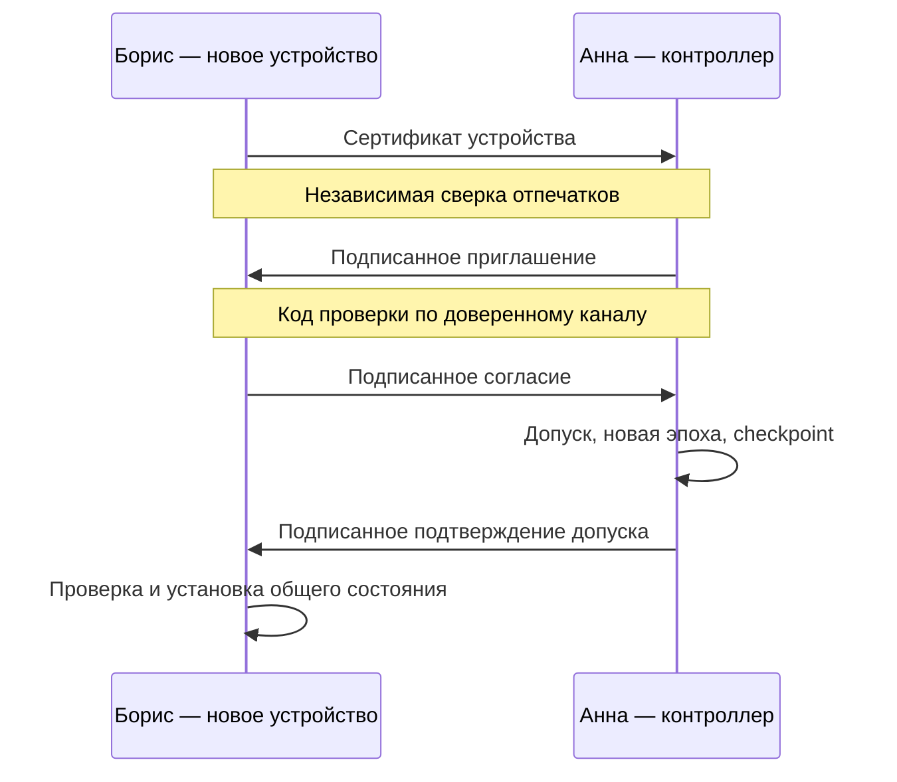

# Как устроена криптография в Lockbox и почему подключение участников состоит из нескольких шагов

Разбор текущей реализации по состоянию на 1 ноября 2026 года.

В Lockbox криптография решает несколько разных задач одновременно: защищает файл на диске, устанавливает личность автора изменений, распределяет доступ к общим данным и позволяет устройствам работать без постоянного соединения с сервером. Именно сочетание этих задач объясняет большую часть сложности проекта. Шифрование само по себе не отвечает на вопросы «кто добавил этого участника?», «мог ли он менять пароли?» и «какая из двух противоречащих историй настоящая?». Для этого вокруг шифрования построен отдельный протокол.

Ниже разобрана текущая реализация в репозитории. Это существенная оговорка: большой документ `lockbox-protocol.md` описывает более широкий проект протокола, а некоторые справочные страницы отстают от кода. Сейчас новые локальные файлы записываются в формате **v6**, облачные профили — **v7**, внутренняя схема облачного профиля имеет номер **5**, а новые общие пространства используют единый экспериментальный протокол без номера версии. Версии локального хранения независимы от протокола синхронизации. Их актуальные значения видны в [формате файла](../src/vault/format.rs), [создании профиля](../src/vault/profile.rs) и [схемах протокола](../src/sync/protocol/machine/protocol.rs).

Начнём с ситуации, ради которой всё это существует. Анна хранит пароли на ноутбуке и хочет дать Борису доступ к общему хранилищу. Затем Борис подключит ещё одно устройство. Оба будут иногда работать без сети. Позже один ноутбук может потеряться, а доступ к нему потребуется отозвать.

Если просто передать Борису копию зашифрованного файла вместе с паролем, он сможет читать данные. Но Анна и Борис окажутся неразличимы: оба знают один секрет. Нельзя будет убедительно установить автора изменения, отдельно запретить редактирование одному из них или безопасно отличить новый компьютер от копии старого. Если поверх этого начать синхронизировать файл целиком, параллельные изменения будут перезаписывать друг друга.

Lockbox разделяет эти вопросы. У каждого устройства есть собственная локальная защита и собственные ключи подписи. У общего пространства есть отдельные ключи содержимого. Состав участников существует как подписанная история решений, а изменения записей — как другая подписанная история, связанная причинными зависимостями.

Для ориентира полезно сразу различить основные ключи:

| Ключ | Что он позволяет |
| --- | --- |
| Ключ локального файла | Расшифровать конкретный профиль `.lbx` |
| Корневой ключ пользователя Ed25519 | Подтверждать принадлежность устройств пользователю; участвовать в специальных операциях восстановления |
| Ключ подписи устройства Ed25519 | Подписывать изменения и разрешённые этому устройству действия |
| Закрытый ключ устройства X25519 для HPKE | Получать адресованные устройству ключи общих данных |
| Ключ эпохи | Получать ключи шифрования данных при определённом составе участников |
| Ключ изменений | Шифровать содержимое событий редактирования |
| Ключ checkpoint | Шифровать исходный снимок состояния для эпохи |

Это разные возможности. Например, мастер-пароль открывает локальный файл, но сам по себе не назначает человека владельцем общего пространства. А знание ключа общих данных позволяет читать записи, но не даёт права выдавать свои изменения за изменения другого устройства.

Первый слой защиты — локальный файл `.lbx`. В обычном локальном режиме это само хранилище. В облачном режиме это ещё и личный профиль установки: внутри находятся ключи устройства, настройки подключения, журнал синхронизации и другие данные, необходимые для продолжения работы.

Пароль человека не используется непосредственно как ключ шифрования. Программа сначала обрабатывает его функцией **Argon2id**. По умолчанию заданы 256 МиБ памяти, три прохода и четыре линии параллелизма. К паролю добавляется случайная соль длиной 16 байт. Эти параметры находятся в [коде локального хранилища](../src/vault/mod.rs).

Соль не обязана быть секретной. Её задача — сделать обработку пароля индивидуальной для файла. Даже одинаковые пароли в двух независимо созданных хранилищах не должны давать одинаковые результаты.

Argon2id намеренно требует заметных вычислений и памяти. Для законного пользователя это задержка при открытии. Для атакующего, который украл файл и перебирает миллионы вариантов пароля, это стоимость каждого варианта. Устройство Argon2 и смысл затрат памяти описаны в [RFC 9106](https://www.rfc-editor.org/rfc/rfc9106).

После Argon2id применяется **HKDF-SHA256**. Из полученного материала выводятся два разных значения: ключ шифрования файла и проверочное значение пароля. Они разделены строками назначения:

```text
lockbox v1 encryption
lockbox v1 password check
```

Схематически:

```text
M = Argon2id(пароль, соль, параметры)

K_file = HKDF-SHA256(M, назначение «encryption»)
check  = HKDF-SHA256(M, назначение «password check»)
```

Здесь у Argon2id и HKDF разные обязанности. Argon2id делает перебор человеческого пароля дорогим. HKDF позволяет получать отдельные ключевые значения для разных целей. Увеличение числа производных ключей не увеличивает непредсказуемость исходного пароля: слабый пароль остаётся слабым. Сам механизм разделения ключей описан в [RFC 5869](https://www.rfc-editor.org/rfc/rfc5869.html), а конкретные строки и вычисления — в [функции `derive`](../src/vault/format.rs).

Проверочное значение хранится в заголовке файла. При открытии программа вычисляет его заново и сравнивает с сохранённым. Это позволяет сообщить о неверном пароле до разбора содержимого. При этом проверка не устраняет возможность автономного перебора украденного файла: атакующий тоже может проверять догадки, каждый раз оплачивая вычисление Argon2id.

Само содержимое зашифровано алгоритмом **XChaCha20-Poly1305**. Он совмещает шифрование и проверку целостности. Без ключа нельзя прочитать данные, а изменение защищённых байтов должно приводить к ошибке проверки.

Для каждого сохранения создаётся новый случайный **nonce** длиной 24 байта. Nonce — дополнительный параметр операции шифрования; его можно хранить открыто. Его нельзя путать с ключом. Повтор одного и того же nonce с одним ключом опасен, поэтому программа генерирует новое значение при сохранении. Именно расширенный 192-битный nonce отличает используемый вариант XChaCha20-Poly1305 от обычного ChaCha20-Poly1305. Это подтверждает [документация RustCrypto](https://docs.rs/chacha20poly1305/0.10.1/chacha20poly1305/).

У файла есть открытый заголовок длиной 90 байт: сигнатура формата, версия, параметры Argon2id, соль, проверочное значение и nonce. Заголовок нужен до расшифрования, поэтому скрыть его целиком нельзя. Однако он передаётся в алгоритм как **AAD**, то есть дополнительные аутентифицируемые данные. Его содержимое остаётся видимым, но связано с проверкой целостности шифротекста. Незаметно изменить параметры или подставить другой заголовок к прежнему содержимому не получится. Это непосредственно реализовано в [шифровании и расшифровании файла](../src/vault/format.rs).

Внутри шифруются записи, папки, история, имена и байты вложений. В облачном профиле туда же входят credentials провайдера и закрытые ключи устройства. Сам профиль не предназначен для загрузки в общий bucket: другие участники должны получать общие данные через протокол, сохраняя собственные личные профили.

Отсюда важное следствие: **участникам общего пространства не требуется одинаковый мастер-пароль**. Анна открывает свой профиль своим паролем, Борис — своим. Общими являются ключи содержимого пространства, которые доставляются устройствам отдельным механизмом.

В облачном профиле появляется второй пароль — пароль восстановления. Он защищает корневой ключ пользователя внутри отдельной зашифрованной «капсулы». У капсулы собственная случайная соль, собственный nonce и отдельное назначение HKDF. Даже после открытия внешнего файла мастер-паролем закрытый корневой ключ остаётся зашифрованным. Реализация находится в [`RootCapsule`](../src/vault/profile.rs).

Это разделение полномочий. Обычная работа требует доступа к записям и ключам конкретного устройства. Создание новой доверенной установки от имени прежнего пользователя требует более сильного действия — обращения к корневой идентичности. Поэтому пароль восстановления не запрашивается при каждом редактировании или обычном приглашении участника.

В интерфейсе создания облачного профиля оба пароля должны иметь не менее 12 символов и различаться. Но пароль восстановления не является универсальной кнопкой сброса мастер-пароля. В текущей схеме капсула находится внутри внешнего зашифрованного профиля. Чтобы воспользоваться ею, сначала нужен доступ к содержимому этого профиля — например, через мастер-пароль или иной поддерживаемый способ открытия. Эти проверки и порядок действий видны в [сценарии авторизации](../src/access/auth.rs).

Теперь можно перейти от защиты файла к идентичности.

В Lockbox пользователь определяется корневой парой **Ed25519**. Закрытая часть позволяет подписывать, открытая — проверять подписи. Ed25519 здесь используется именно для подписей. Его назначение и устройство описаны в [RFC 8032](https://www.rfc-editor.org/rfc/rfc8032).

Идентификатор пользователя вычисляется как SHA-256 от открытого корневого ключа с префиксом назначения:

```text
user_id = SHA256("lockbox.user\0" || root_public_key)
```

Идентификатор устройства аналогично получается из его открытого ключа подписи:

```text
device_id = SHA256("lockbox.device\0" || device_signing_public_key)
```

Знак `||` означает соединение байтов. Префиксы разделяют назначения: хеш пользователя и хеш устройства принадлежат разным контекстам. Полученные идентификаторы имеют длину 32 байта и отображаются как 64 шестнадцатеричных символа. Эти вычисления находятся в [коде идентичности](../src/sync/identity.rs).

Отображаемое имя пользователя не является доказательством личности. Любой может назвать свой профиль «Анна». Криптографическое утверждение гораздо уже: «это устройство связано с таким-то корневым ключом». Связь этого ключа с конкретным человеком устанавливается при независимой сверке.

У каждого устройства есть две отдельные пары ключей. Первая — Ed25519 для подписи событий. Вторая — X25519 для получения зашифрованных ключей через HPKE. Они создаются независимо от корневого ключа.

Корневой ключ подписывает **сертификат устройства**. В сертификате связаны идентификатор пользователя, корневой открытый ключ, идентификатор устройства, открытый ключ подписи устройства и открытый ключ HPKE. Проверяющая сторона может убедиться, что сертификат подписан соответствующим корнем и что идентификаторы правильно вычислены из ключей. Это реализовано в [проверке сертификата](../src/sync/protocol/crypto.rs).

Но сертификат ещё не означает допуск в чужое хранилище. Он подтверждает принадлежность устройства определённой идентичности. Разрешение войти в пространство выдаётся отдельным подписанным решением.

Такое разделение позволяет пользователю иметь несколько устройств и отзывать доступ у одного из них. Потерянный ноутбук — конкретная установка со своими ключами, а не вся личность пользователя.

Именно поэтому копировать облачный `.lbx` на другой компьютер как способ подключения нельзя. Вместе с файлом копируются закрытые ключи устройства и состояние его журнала. Две установки начнут действовать от имени одного устройства и могут создавать противоречащие события. Новый компьютер должен получить собственные ключи и отдельный допуск.

У общего пространства тоже есть идентичность. Её описывает `SpaceDescriptor`, включающий идентификатор пространства, случайный namespace хранения, корневой открытый ключ владельца и хеш начального управляющего события — **genesis**.

Namespace указывает, где искать объекты. Он не предоставляет права читать или изменять записи. Genesis закрепляет начало истории управления. Корневой ключ владельца задаёт исходную доверенную идентичность. Эти значения должны быть аутентифицированы при подключении: название bucket или успешный вход в Storj такой проверки не заменяют.

Состав участников хранится в подписанных управляющих событиях — `Control`. Каждое следующее событие связано с предыдущим. Внутри находятся полный состав устройств, их роли, сведения об эпохе, адресованные устройствам ключевые пакеты и зашифрованный снимок состояния.

В пространстве различаются владелец как пользовательская идентичность и **контроллер** как конкретное устройство, уполномоченное подписывать следующие решения о составе участников. Дополнительное устройство владельца не становится контроллером автоматически.

Участник может иметь роль `Reader`, `Editor` или `Owner`. Читатель получает возможность читать общие данные. Редактор может подписывать изменения. Управление составом участников принадлежит текущему контроллеру. Устройства одного пользователя должны иметь согласованную роль; роль в текущей реализации относится к пространству в целом, а не к отдельной папке или записи. Правила проверяются в [коде состава участников](../src/sync/protocol/machine/membership.rs).

Возникает закономерный вопрос: если читатель получил ключ расшифрования, что мешает ему зашифровать собственную правку?

Зашифровать байты он действительно способен. Общий симметричный ключ не различает участников. Поэтому каждое событие дополнительно подписано ключом устройства. Получатель проверяет, входит ли автор в состав участников соответствующей эпохи и разрешала ли его роль создавать изменения. Событие читателя будет отклонено даже с корректной подписью самого читателя и корректным шифрованием. Порядок этих проверок виден в [аутентификации изменений](../src/sync/protocol/machine/replay.rs).

Так подпись и шифрование дополняют друг друга: одно скрывает содержимое от посторонних, другое устанавливает автора и позволяет проверить его полномочия.

Для общих данных используется понятие **эпохи**. Эпоха задаёт период действия определённого состава участников и ролей. При добавлении устройства, удалении, изменении роли или отдельной ротации создаются новый случайный ключ эпохи и новый случайный контекст.

Из ключа эпохи через HKDF-SHA256 выводятся разные ключи для изменений и checkpoint. В вычисление входят идентификатор пространства и контекст эпохи. Назначения разделены строками:

```text
lockbox.changes\0
lockbox.checkpoint\0
```

Поэтому шифрование обычных правок и шифрование снимка состояния используют разные ключи, хотя опираются на один ключ эпохи. Конкретное вычисление находится в [функции `content_key`](../src/sync/protocol/crypto.rs).

Остаётся доставить ключ эпохи каждому разрешённому устройству. Здесь применяется **HPKE**: комбинация X25519, HKDF-SHA256 и ChaCha20-Poly1305 в режиме Base. Для каждого устройства создаётся отдельный зашифрованный пакет — `grant`. Полезная нагрузка пакета содержит ключ эпохи.

HPKE обеспечивает получение содержимого обладателем соответствующего закрытого ключа. Режим Base сам по себе не удостоверяет личность отправителя; в Lockbox это обеспечивается внешней подписью управляющего события. Дополнительные аутентифицируемые данные связывают пакет с эпохой и хешем точного сертификата получателя. Такой состав механизмов соответствует возможностям, описанным в [RFC 9180](https://www.rfc-editor.org/rfc/rfc9180).

Зачем столько ключей вместо отдельного шифрования каждой записи для каждого человека? Потому что общий массив данных можно шифровать одним ключом содержимого, а небольшие пакеты с ключом эпохи — адресно для устройств. При изменении состава участников меняется эпоха, и новый ключ получают только разрешённые устройства. Создание пакетов и checkpoint находится в [коде управляющего события](../src/sync/protocol/machine/membership.rs).

На этой основе работает добавление нового пользователя. На практике допускается конкретное устройство с конкретным сертификатом. Если сертификат относится к новому корню, появляется новый пользователь. Если к уже известному — подключается ещё одно устройство той же идентичности.

В текущем настольном интерфейсе обмен организован через файлы:



Перед обменом у Бориса создаётся независимый облачный профиль с собственными ключами, мастер-паролем и настройками провайдера. Для обычного подключения он должен быть пустым. Программа не должна незаметно выбросить его существующие записи или заменить историю другого пространства.

Дальше идут шесть пользовательских шагов.

1. **Борис готовит файл своего устройства и передаёт Анне.** В нём находится публичный сертификат. Закрытые ключи остаются у Бориса. Анна сверяет отпечатки пользователя и устройства через доверенный канал. Это нужно потому, что корректный сертификат злоумышленника тоже будет математически корректным: его подпись доказывает принадлежность его собственному корню, но не связь с Борисом.

2. **Анна проверяет сертификат и создаёт адресное приглашение.** Она выбирает право чтения или редактирования и срок действия. Подписанное предложение содержит случайный идентификатор приглашения, полный дескриптор пространства, проверенный управляющий якорь, точный сертификат получателя, роль и необязательный срок. Приглашение связано с определённым устройством; произвольный обладатель файла не может заменить получателя собой.

3. **Анна передаёт файл приглашения и отдельно код проверки.** Код — 64 шестнадцатеричных символа, вычисленные как хеш полного дескриптора пространства и управляющего якоря. Это публичный контрольный отпечаток, а не пароль расшифрования. Его задача — дать Борису независимое подтверждение того, какое пространство и какую управляющую историю предлагает именно Анна. Если злоумышленник может заменить и файл, и код в одном канале, эта независимость теряется.

4. **Борис открывает приглашение, вводит полученный код и подписывает согласие.** Программа проверяет историю управления, полномочия отправителя, подпись приглашения и совпадение адресованного сертификата с собственными ключами устройства. Затем Борис подписывает хеш точного предложения, идентификатор своего устройства и случайный challenge. Согласие связано с конкретным предложением, включая назначенную роль. На этом шаге Борис ещё не добавляет себя в состав участников.

5. **Анна получает согласие и выполняет допуск.** Программа требует точное локально выданное приглашение, проверяет подпись Бориса, отмену, срок действия и состояние предыдущих попыток. После этого создаётся новое управляющее событие: в него входят доказательства приглашения и согласия, обновлённый состав участников, новая эпоха, зашифрованный checkpoint и пакеты ключа для разрешённых устройств. Событие проходит сохранение и подписание.

6. **Анна отправляет подтверждение допуска, Борис завершает подключение.** Подтверждение подписано контроллером и связывает пространство, приглашение, точный хеш согласия и управляющую вершину истории. Борис проверяет цепочку, находит собственный допуск, закрепляет подтверждённую вершину и устанавливает доступное ему состояние. После этого начинается обычная синхронизация.

Этот обмен подробно описан в [руководстве по приглашениям](sync-invitations.md#desktop-workflow), а проверки реализованы в [машине приглашений](../src/sync/protocol/machine/invitations.rs).

Каждый переход отвечает на отдельный вопрос. Сертификат сообщает, какие ключи принадлежат устройству. Приглашение фиксирует решение контроллера предложить доступ. Код связывает предложение с независимо проверенным пространством. Согласие подтверждает владение ключом подписи получателя и принятие точных условий. Управляющее событие действительно меняет состав участников. Подтверждение сообщает получателю, что допуск состоялся, и закрепляет подписанную точку истории.

Файлы обмена не содержат закрытых ключей устройств, credentials провайдера или открытых записей. Они могут содержать публичные сведения об участниках, зашифрованные пакеты ключей и зашифрованные checkpoint. Следовательно, их утечка не равна передаче открытого хранилища, но публичная информация о составе пространства всё же раскрывается.

При этом именно такое количество диалогов и пересылок файлов не является математической необходимостью. Сообщения можно было бы передавать автоматически через приложение или другой транспорт. Криптографические подтверждения всё равно понадобились бы, но часть ручных действий можно скрыть за удобным интерфейсом. Сейчас явный файловый обмен делает границы доверия видимыми.

У срока приглашения есть тонкость. Его проверяет установка контроллера при допуске. Устройства при последующем воспроизведении истории не используют собственные часы, чтобы задним числом решить, существовали ли полномочия. Иначе часы с разным временем давали бы разный состав участников.

Если допуск уже зарезервирован, он должен завершиться как та же самая операция даже после наступления срока. Для последующего удаления используется новое решение об отзыве доступа. Точно так же отмена приглашения должна переживать перезапуск: это сохранённое состояние контроллера, а не временная отметка в окне.

Приглашения, согласия и подтверждения сохраняются до экспорта. Повтор действия после сбоя возвращает прежний документ с прежней подписью. Это предотвращает появление нескольких разных ответов на одну и ту же незавершённую операцию. Эти правила находятся в [долговечном журнале приглашений](../src/vault/sharing.rs).

После подключения Борис получает checkpoint — зашифрованный снимок состояния на границе эпохи. Он позволяет начать работу без старых ключей всех предыдущих эпох.

Здесь различаются два вида проверки. Участник, который уже обладал прежними ключами и полной историей, может самостоятельно воспроизвести изменения и сравнить результат с checkpoint. Новый участник без старых ключей получает снимок, удостоверенный контроллером, но не может независимо подтвердить весь путь получения прежнего открытого содержимого.

В коде это отражено флагом `history_verified`: при пропуске эпох, для которых у устройства нет ключевого пакета, полная проверка прежнего содержимого не заявляется. Новый участник может доверять текущему снимку в рамках полномочий контроллера, но это не превращается в независимое доказательство всех прежних редакций. Разница видна в [воспроизведении истории](../src/sync/protocol/machine/replay.rs).

Теперь рассмотрим обычное редактирование. Когда Анна меняет пароль, Lockbox создаёт транзакцию. В неё входят изменения сущностей и ссылки на версии, которые Анна видела и намерена заменить.

У события есть открытый заголовок: версия протокола, пространство, управляющее событие, эпоха, устройство-автор, порядковый номер, предыдущее событие этого устройства, причинные родители и nonce. Транзакция шифруется ключом изменений эпохи, а заголовок используется как AAD. Затем устройство подписывает заголовок вместе с шифротекстом. Этот путь находится в [подготовке события](../src/sync/protocol/machine/commands.rs).

Так нельзя незаметно поменять содержимое, перенести событие в другое пространство, приписать его другому автору или изменить его причинные ссылки. Но корректной подписи всё ещё недостаточно: получатель проверяет роль автора, зависимости, последовательность событий и допустимость всей транзакции относительно её причинного прошлого.

Для подписей нужны однозначные байты. Поэтому сетевые объекты кодируются в каноническом JSON по JCS. Программа разбирает объект, заново канонически кодирует и требует точного совпадения с полученными байтами. Альтернативные представления, дублирующиеся ключи и неизвестные поля отклоняются. Счётчики передаются каноническими десятичными строками, хеши — строчными шестнадцатеричными строками, подписи и шифротексты — base64url без заполнения. Это описано в [сетевом кодировании](../src/sync/protocol/wire.rs).

У разных видов подписей есть отдельные префиксы назначения. Подпись согласия нельзя автоматически использовать как подпись изменения или управляющего решения. Разделение контекстов встречается здесь постоянно: в идентификаторах, выводе ключей, хешах объектов и подписях.

Особенно много внутренних шагов возникает при сохранении. Причина — возможность сбоя между вычислением подписи, записью файла и отправкой в сеть.

Представим, что устройство создало событие с номером 42 и отправило его, но не сохранило у себя. После перезапуска оно считает, что последним был номер 41. Следующая правка получает тот же номер 42, но другое содержимое. Теперь существуют два подписанных события одного устройства в одной позиции последовательности. Для протокола это противоречие в истории устройства.

Чтобы избежать такого состояния, Lockbox сначала готовит точное зашифрованное тело будущего события — вместе с выбранными nonce, зависимостями и номером. Это **намерение подписи**, `intent`. Оно сохраняется на диск до создания подписи.

Затем устройство подписывает именно сохранённое тело. После этого событие, новый вид записей и очередь исходящих объектов `outbox` сохраняются в локальном профиле. Только после такого сохранения байты можно публиковать.

Если программа упала после сохранения намерения, она завершит прежнюю операцию. Ed25519 детерминированно воспроизводит подпись тех же байтов, поэтому повтор не требует создания другого события. Если сервер принял объект, но ответ потерялся, повторно отправляются те же байты под тем же хешем. Подтверждение отправки фиксируется отдельно. Границы видны в [сохранении и восстановлении намерения](../src/vault/shared.rs) и [его завершении](../src/sync/protocol/machine/commands.rs).

Поэтому один пользовательский клик может приводить к нескольким физическим сохранениям. Каждое фиксирует определённую границу: «вот что я собираюсь подписать», «вот что уже подписано и сохранено», «вот что подтверждено транспортом».

Сам файл заменяется через временный файл, синхронизацию на диск и переименование. Предыдущая версия сохраняется как резервная копия. Но атомарная запись решает только вопрос целостности отдельного сохранения. Она не мешает человеку восстановить старую, полностью корректно зашифрованную копию.

Для этого существует независимый **witness**, локальное свидетельство последнего поколения профиля.

Внутри зашифрованного профиля записываются привязка установки, номер поколения файла и хеш предыдущей версии. Отдельно от него хранится свидетельство с идентификатором профиля, той же привязкой, максимальным поколением и хешем файла. На macOS используется отдельная запись Keychain; на других настольных платформах — каталог установки. Свидетельство не содержит паролей записей или закрытых ключей.

После открытия профиль сравнивается с этим независимым состоянием. Если восстановлена старая копия, записи остаются читаемыми, но подписание и обмен останавливаются. Иначе восстановленный файл мог бы воскресить старые счётчики, неотправленные события или отменённые решения.

Допускается строго определённый случай восстановления после сбоя: файл оказался ровно на одно связанное поколение впереди свидетельства. Это соответствует ситуации, когда запись файла завершилась, а обновление witness ещё не успело. Произвольный разрыв поколений или другие несовпадения не считаются таким сбоем. Правила находятся в [согласовании поколений](../src/vault/anchor.rs).

При чтении кода важно не смешивать три разных счётчика:

| Счётчик | Что он упорядочивает |
| --- | --- |
| Поколение файла | Сохранения локального защищённого профиля |
| Номер события устройства | Подписанные события устройства в рамках эпохи |
| Номер эпохи | Переходы состава участников и ключевого состояния |

Дополнительно действуют блокировка открытого файла и исключительное право использовать идентичность подписывающего устройства на установке. Это мешает двум процессам одновременно продолжать одну историю, даже если профиль скопирован по разным путям. Подробности описаны в [защите профиля](profile-protection.md#independent-installation-evidence).

Witness тоже имеет границу возможностей. Если восстановить одновременно и старый профиль, и старое независимое свидетельство, локальная проверка может потерять доказательство отката. Это не аппаратный монотонный счётчик. Для таких случаев нужны сведения от независимого доверенного устройства или восстановление с новой идентичностью устройства.

В облаке Lockbox обменивается неизменяемыми объектами, адресуемыми по хешу. Путь имеет вид:

```text
spaces/<namespace>/objects/<hash>.json
```

Хеш позволяет проверить соответствие полученных байтов запрошенному объекту. Подпись устанавливает автора, а история управления — его полномочия. Эти проверки нельзя заменить друг другом.

Storj выступает транспортом и хранилищем объектов. HTTPS защищает соединение, SigV4 удостоверяет запросы к S3 API. Credentials провайдера позволяют выполнять разрешённые операции хранения, но не превращают устройство в участника Lockbox. Обратная ситуация тоже возможна: криптографически допущенное устройство без нужного доступа к провайдеру не сможет получать объекты.

Поэтому credentials лучше понимать как доступ к каналу доставки, а сертификаты, роли и подписанные управляющие события — как правила самого пространства. Вход в bucket не даёт права назначать участников.

Сервер способен задержать ответ, скрыть объект или выдать неполный список. Протокол не должен считать порядок `LIST` порядком событий. Он дополнительно запрашивает известные зависимости по хешам, а отсутствие объекта рассматривает как неполноту истории. Уже известное локальное событие не исчезает только потому, что его перестали показывать.

Но подписи не доказывают, что сервер показал всё. Если устройство никогда не видело более поздний отзыв доступа, оно не может вычислить факт его существования из старого корректного префикса. Подписанное подтверждение допуска мешает незаметно обрезать приложенное доказательство относительно подписанной вершины, однако само по себе не доказывает отсутствие более поздних решений. Для свежести нужны независимо полученные актуальные якоря и последующее обнаружение истории. Эта граница прямо отмечена в [описании приглашений](sync-invitations.md#persistence-and-local-policy).

Параллельная работа устроена через причинные ссылки. Если Анна и Борис видели одну версию записи, затем независимо изменили её без сети, их изменения не упорядочены друг относительно друга. У обоих может быть корректная подпись и достаточная роль.

Lockbox сохраняет обе версии. Время на часах не выбирает победителя. Для менеджера паролей это разумное свойство: более поздняя по часам запись не обязательно содержит действующий пароль, а автоматическое объединение отдельных полей может создать бессмысленную комбинацию.

Разрешение конфликта — новое подписанное действие, которое явно учитывает все известные версии. Если позже приходит ещё одна ранее неизвестная параллельная правка, конфликт может появиться снова: прежнее решение не могло разрешить то, чего автор ещё не видел. Принцип хранения полных версий виден в [модели проекции](../src/sync/protocol/model.rs).

Отзыв доступа тоже сложнее удаления строки из списка. Контроллер создаёт новое управляющее событие, удаляет устройство из состава, генерирует новый ключ эпохи, формирует checkpoint и адресует новый ключ оставшимся устройствам. Удалённое устройство не получает пакет новой эпохи.

Одновременно фиксируется **закрывающий причинный фронтир** старой эпохи: какие старые события и их предки вошли в принятый результат. Это нужно, чтобы после отзыва удалённое устройство не могло бесконечно дописывать события со ссылкой на прежние полномочия.

Цена такого правила проявляется при обычной работе без сети. Допустим, Борис сделал правку до того, как узнал о смене эпохи, но контроллер не видел её при закрытии. Эта правка может остаться за пределами принятой истории. Lockbox сохраняет её для просмотра как исключённое изменение, а перенос требует явного действия `rebase`.

При переносе создаётся новое событие с текущими полномочиями и подписью нынешнего автора. Старое событие не переписывается. Ссылка `rebased_from` указывает происхождение, но не выдаёт новое действие за старую подпись Бориса. Это объяснено в [описании закрытия эпох](sync-engine.md#membership-and-validation).

Отзыв доступа защищает последующие данные новой эпохи в пределах принятой модели. Он не стирает уже полученное. У Бориса могут остаться старые записи, ключи, выгрузки и резервные копии. Если ему был известен пароль от внешнего сервиса, удаление устройства из Lockbox этот пароль не меняет. Для прекращения доступа к самому сервису нужно менять его секрет отдельно.

Удалённый идентификатор устройства также нельзя просто допустить повторно. Для возвращения требуются новые ключи подписи и HPKE и новое приглашение. Так прежняя история отозванной установки не смешивается с новой.

Восстановление пользователя и восстановление контроллера — ещё два разных сценария.

При восстановлении обычного устройства читаемая резервная копия и пароль восстановления позволяют открыть корневую капсулу и создать новое устройство той же пользовательской идентичности. Оно получает свежие ключи подписи и HPKE. Старые закрытые ключи устройства, счётчики, исходящая очередь и ключи эпох не переносятся как действующее состояние.

Кроме резервной копии нужен независимо аутентифицированный дескриптор и актуальный управляющий якорь. Новое устройство ждёт явного допуска, затем получает текущий checkpoint. Старые записи из резервной копии остаются материалом для проверки, но не должны автоматически перезаписать современное общее состояние. Этот путь реализован в [`restore_device`](../src/vault/store.rs).

Если потерян контроллер, задача другая: нужно восстановить само право продолжать историю управления. В протоколе синхронизации для этого уже есть отдельный API. Он требует корневую власть владельца с паролем восстановления, актуальное читаемое содержимое и независимо проверенный `RecoveryAnchor`.

Такой якорь включает дескриптор, управляющий хеш и точный фронтир данных. Одного совпадения управляющего события недостаточно: резервная копия могла содержать старые записи при том же составе участников.

Восстановление создаёт свежее устройство, удаляет потерянный контроллер, сохраняет остальных участников, меняет ключ эпохи и формирует checkpoint. Корневой ключ одобряет подготовленное решение, а новое устройство подписывает окончательное управляющее событие. Отдельный журнал корневых операций защищает от случайного создания конкурирующих локальных заявок при повторах. Условия описаны в [восстановлении контроллера](sync-control-recovery.md#lost-controller-recovery).

Есть и обычная передача управления между устройствами владельца: старый контроллер готовит предложение, новый подтверждает принятие, старый завершает переход. Пользовательская идентичность владельца остаётся прежней. Бывший контроллер сохраняет обычный доступ к данным, пока его отдельно не удалят. Эти методы присутствуют в [API управления](../src/vault/authority.rs), хотя некоторые старые фразы документации ещё говорят об отсутствии такой возможности. Полные настольные мастера восстановления и передачи управления остаются незавершённой работой.

Если обнаруживаются две допустимые управляющие ветки или два разных действительных события устройства в одной активной позиции последовательности, пространство замораживается. Программа сохраняет последнюю читаемую картину и доказательства противоречия. Выбор по времени, по меньшему хешу или по порядку получения позволил бы разным устройствам принять разные истории, поэтому такого автоматического выбора нет.

Существуют и криптографические ограничения, которые нельзя устранить дополнительными проверками интерфейса.

Ключи эпох меняются при переходах состава, но текущая схема не даёт полной прямой секретности истории относительно компрометации закрытого HPKE-ключа получателя. Если атакующий получит этот ключ и сохранённые адресованные ему старые пакеты, он сможет расшифровать соответствующие ключи эпох. Это следует из свойства HPKE, описанного в [разделе о forward secrecy RFC 9180](https://www.rfc-editor.org/rfc/rfc9180#section-9.7.4), и из использования долговременного ключа устройства в Lockbox.

Облако также видит метаданные объектов: публичные сертификаты, роли, идентификаторы устройств, причинные связи, размеры шифротекстов. По обращениям к сервису можно наблюдать активность. Содержимое записей зашифровано, однако протокол не обеспечивает сокрытие всех сведений о взаимодействии участников.

Защита памяти ограничена средой исполнения. Rust-структуры с секретами используют механизмы обнуления при освобождении. Но показанные и введённые значения проходят через WebView, JavaScript и виртуальный DOM. Гарантировать уничтожение всех таких копий нельзя; это прямо указано в [README](../README.md).

Touch ID шифрует ключ файла с помощью ключа Secure Enclave: расшифрование требует биометрии через ограничение `biometryCurrentSet`, которое проверяет сам Secure Enclave. Ключ доступен только на этом устройстве при разблокированной системе. В login Keychain сохраняются только шифротекст и зашифрованное представление ключа Secure Enclave; синхронизация отключена. Такой способ работает и в сборках без подписи Apple и Keychain entitlements. Старые незащищённые записи удаляются; после обновления нужен мастер-пароль для создания нового зашифрованного контейнера. Требования и проверка описаны в [документации Touch ID](touch-id.md). Корневая капсула остаётся защищена паролем независимо от Touch ID.

TOTP-коды относятся к другому механизму. В записи хранится общий секрет внешнего сервиса. Программа вычисляет код через HMAC от временного счётчика, обычно с периодом 30 секунд и шестью цифрами; поддерживаются SHA-1, SHA-256 и SHA-512. Это реализация [RFC 6238](https://www.rfc-editor.org/rfc/rfc6238.html), находящаяся в [модуле TOTP](../src/records/totp.rs). Часы необходимы для этих кодов, но не выбирают победителя среди событий синхронизации. Хранение пароля и TOTP-секрета в одной записи также означает, что чтение этой записи раскрывает оба секрета.

История, корзина и резервные копии намеренно сохраняют прежние значения. Удаление записи или вложения не является криптографическим уничтожением всех предыдущих копий. Новый участник без прежних ключей может не видеть старые редакции, тогда как прежний участник мог уже сохранить их у себя.

Реализация остаётся экспериментальной: есть ограничения размеров объектов, объёма истории и числа участников; масштабируемое сжатие истории ещё не завершено. По документации проекта проверка обмена с настоящим Storj и независимое криптографическое ревью пока не выполнены. Использование известных алгоритмов и наличие тестов не заменяют проверку того, как они соединены в протоколе.

При подготовке эссе 1 ноября 2026 года был выполнен существующий пример:

```bash
cargo run --locked --offline --example shared_space --quiet
```

Он успешно выполнил подписанный допуск двух независимых профилей, сохранил обе параллельные версии записи, пережил потерю ответа при отправке и синхронизировал явное разрешение конфликта. Пример использует транспорт в памяти и временные профили с вымышленными данными; работа с настоящим Storj этим запуском не проверялась.
