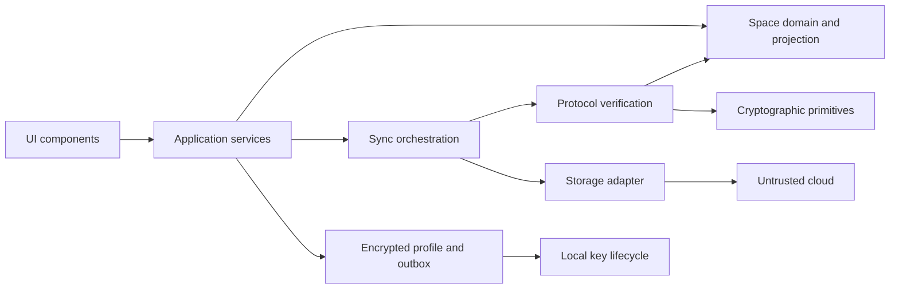
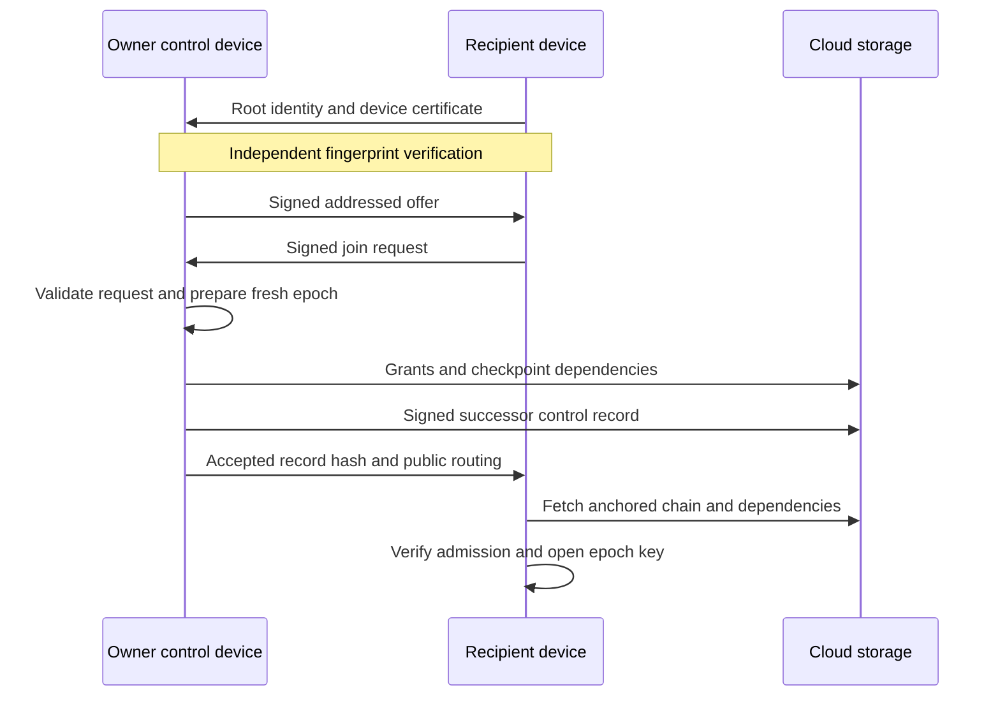
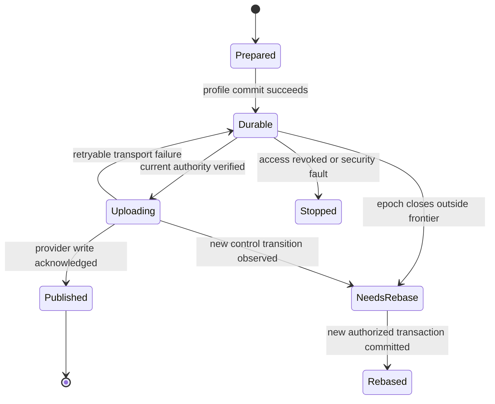

# Lockbox Protocol

Status: expanded architecture draft. Date: 31 October 2026.
Protocol version: 1 proposed. Local profile format: `.lbx` v3 proposed.
Implementation status: local vault exists; shared protocol remains unimplemented.

Lockbox gains independent spaces, verified users and devices, encrypted sharing,
and asynchronous sync through third-party storage. Clients enforce access.
Cloud stores objects; cloud responses never establish identity or permission.

Core design: signed membership chain, independent epoch keys, per-device
signatures, immutable encrypted changes, deterministic conflict handling.
One control device orders membership changes. Editors change data concurrently.
No Lockbox server required for initial deployment.

Normative words `MUST`, `MUST NOT`, and `SHOULD` describe proposed protocol rules.
They become interoperability requirements only after protocol review and freeze.
TypeScript blocks describe schemas; they are not executable implementation or
cryptographic test vectors. Algorithms and identifiers below use one consistent
proposed encoding, replacing ambiguities in the earlier architecture draft.

## Contents

1. [Scope and decisions](#1-scope-and-decisions)
2. [Current implementation](#2-current-implementation)
3. [Terms and version boundaries](#3-terms-and-version-boundaries)
4. [Trust and threat model](#4-trust-and-threat-model)
5. [Roles and authority](#5-roles-and-authority)
6. [Component boundaries](#6-component-boundaries)
7. [Cryptographic profile](#7-cryptographic-profile)
8. [Canonical encoding and object identity](#8-canonical-encoding-and-object-identity)
9. [Users and device certificates](#9-users-and-device-certificates)
10. [Object registry](#10-object-registry)
11. [Membership chain](#11-membership-chain)
12. [Epoch key delivery](#12-epoch-key-delivery)
13. [Invitations](#13-invitations)
14. [Device admission and rotation](#14-device-admission-and-rotation)
15. [Encrypted changes](#15-encrypted-changes)
16. [Validation pipeline](#16-validation-pipeline)
17. [Causal projection and conflicts](#17-causal-projection-and-conflicts)
18. [Folder transactions](#18-folder-transactions)
19. [Checkpoints and audit](#19-checkpoints-and-audit)
20. [Epoch transitions and revocation](#20-epoch-transitions-and-revocation)
21. [Publication and synchronization](#21-publication-and-synchronization)
22. [Storage transport contract](#22-storage-transport-contract)
23. [Provider access and migration](#23-provider-access-and-migration)
24. [Rollback and fork detection](#24-rollback-and-fork-detection)
25. [Local storage and secret lifecycle](#25-local-storage-and-secret-lifecycle)
26. [Recovery and ownership transfer](#26-recovery-and-ownership-transfer)
27. [Existing vault migration](#27-existing-vault-migration)
28. [User interface and diagnostics](#28-user-interface-and-diagnostics)
29. [Limits and error handling](#29-limits-and-error-handling)
30. [Worked protocol cases](#30-worked-protocol-cases)
31. [Rust integration](#31-rust-integration)
32. [Conformance and security tests](#32-conformance-and-security-tests)
33. [Delivery stages](#33-delivery-stages)
34. [Alternatives and remaining decisions](#34-alternatives-and-remaining-decisions)

## 1 Scope and decisions

Space is access boundary. Every admitted device reads every current record in
that space. Different audiences require different spaces. Folders organize
records; folders carry no separate access rules.

Initial decisions:

- Roles: owner, editor, reader.
- One owner user; one designated control device per space.
- Separate signing and encryption keys per device.
- New independent encryption key for every membership epoch.
- Individual HPKE key envelope for every admitted device.
- Concurrent writes represented as causal graph; conflicting secrets preserved.
- New member receives current state and future changes. Historical keys withheld.
- Local changes remain durable without network.
- Sync pauses while application locked.
- First network adapter: S3-compatible object storage, provider selected separately.
- Provider credentials provisioned through provider mechanisms; no universal
  automatic account or credential service assumed.

Excluded initially: per-record permissions, folder permissions, public sharing
links, multiple control writers, automatic history deletion, background signing
while locked, distributed transactions across spaces.

Cross-space move means explicit copy followed by optional separate deletion.
Source and destination cannot commit atomically through unrelated storage.
Readers can export known secrets. Copy prevention is outside cryptographic model.

## 2 Current implementation

[src/vault/mod.rs](../src/vault/mod.rs) encrypts entire JSON vault with
XChaCha20-Poly1305. Master password passes Argon2id and HKDF. Header authenticated
as associated data. New local vaults write v4 and shared profiles write v5;
v1/v2/v3 files remain readable. Attachments are encrypted with their entries.
Save uses temporary file, filesystem synchronization, rename, previous backup.

Current feature modules:

- [src/records](../src/records): entries, folders, editing, import and record views.
- [src/access](../src/access) and [src/sharing](../src/sharing): access and participant workflows.
- [src/sync](../src/sync): protocol, exchange scheduling and transports.
- [src/vault](../src/vault): encrypted persistence and profile protection.
- [src/settings](../src/settings): preferences and config persistence.
- [src/desktop](../src/desktop): shell, contexts, widgets and lifecycle integration.
- [src/platform](../src/platform): native services and background jobs.

[Entry](../src/records/entry.rs) and [Folder](../src/records/folder.rs) already have
stable random IDs. Existing workflows in [workspace.rs](../src/desktop/workspace.rs)
and [directories.rs](../src/records/directories.rs) call the `Vault` mutation API.
Shared mode persists edits through signed local transactions.

New v5 cloud profiles now implement an experimental unversioned sync engine with
independent device identities, signed membership epochs, encrypted events,
deterministic projection, durable outbox and Storj transport. See
[implementation boundaries and API](sync-engine.md). Its compact inline
control/grant/checkpoint schema is unversioned and does not claim
conformance to the full proposal-v1 schemas below. Existing v1/v2 vaults retain
local persistence. Sharing a local vault key alone does not establish individual
authorship.

Local mode remains usable without cloud. Migration and cloud publication are
separate actions. Feature modules own their models, workflows, views and tests;
protocol rules remain independent of persistence, providers and presentation.

## 3 Terms and version boundaries

| Term | Meaning |
|---|---|
| User | Cryptographic identity anchored by root signing public key |
| Device | Independent signing and HPKE keys certified by user root |
| Space | Records, membership policy, keys, and history sharing one access boundary |
| Control device | Device authorized to sign next normal membership transition |
| Epoch | Membership state established by one accepted control record |
| Control record | `SpaceCommit` or explicitly authorized recovery transition |
| Change | Signed encrypted transaction within one membership epoch |
| Causal past | Changes reachable through declared parents, plus epoch baseline |
| Frontier | Sorted set of maximal operation hashes representing causal boundary |
| Projection | Deterministic state computed from checkpoint and verified changes |
| Checkpoint | Encrypted baseline, conflict variants, tombstones, and provenance |
| Admission | Explicit inclusion of exact device certificate in space membership |
| Anchor | Locally retained verified history head or externally verified starting point |

Four versions remain distinct: local `.lbx` format, network protocol,
cryptographic suite, projection semantics. Supporting file format v3 does not
imply support for arbitrary network version or suite.

Epoch is membership version, not wall-clock interval. Epoch numbers start at
`"0"`, increase by one, and have meaning only within verified predecessor chain.

## 4 Trust and threat model

Trusted: genuine local application, operating system randomness, selected
cryptographic implementations, independently verified root keys, admitted
devices within their granted authority. Owner controls admission and attests
bootstrap state supplied to new members.

Storage may replace bytes, replay old objects, omit dependencies, reorder lists,
partition clients, delete data, or acknowledge writes dishonestly. Authorized
readers may craft ciphertexts. Editors may intentionally publish harmful but
authorized edits. Endpoint compromise exposes secrets available to endpoint.

| Threat | Enforced protection | Limit |
|---|---|---|
| Storage reads passwords | Client-side encryption | Traffic metadata visible |
| Storage alters object | Content hash, signature, AEAD | Missing data can stop progress |
| Outsider claims authorship | Device signature and certificate verification | Spam still consumes resources |
| Reader writes ciphertext | Role checked independently of AEAD | Shared encryption key is not write authority |
| Removed device writes old epoch | Closed frontier excludes newly submitted old operations | Offline client may not know removal yet |
| Directory substitutes identity key | Independent fingerprint verification | Self-signature does not prove human identity |
| Storage replays prefix | Persisted local anchors | New device needs independent starting anchor |
| Storage serves split histories | Fork evidence and independent head comparison | Fully isolated clients cannot guarantee detection |
| Editor deletes legitimate records | Signed tombstones, preserved provenance | Authorized malicious edits remain possible |
| Device stolen while unlocked | Revoke device, rotate affected spaces | Previously readable secrets treated as exposed |

Signatures establish authenticity, not completeness or fresh delivery. Same
delivery limitation appears in [RFC 9750 section 5.2](https://www.rfc-editor.org/rfc/rfc9750.html#section-5.2).

### Visible metadata

Clear membership records expose pseudonymous users, public keys, roles, admitted
devices, membership changes. Change headers expose author device, causal links,
epoch, ciphertext length. Provider also sees request timing and network origin.
Reusing root identity links participation across spaces visible to provider.

The space name is visible in S3 keys, signed invitations and local unlock settings.
Record titles, passwords, TOTP secrets, folder hierarchy, participant aliases,
transaction actions, and entity IDs stay encrypted. Protocol does not claim
anonymous membership or unobservable traffic. Per-space pseudonyms and padding
would require separate design and cost analysis.

## 5 Roles and authority

| Action | Owner | Editor | Reader |
|---|---|---|---|
| Read and export current secrets | Yes | Yes | Yes |
| Create, edit, delete records and folders | Yes | Yes | No |
| Resolve data conflicts | Yes | Yes | No |
| Admit users and devices | Control device | No | No |
| Change roles or revoke access | Control device | No | No |
| Change provider binding | Control device | No | No |
| Recover control authority | Owner root with recovery rules | No | No |

Owner user identity and control device are different concepts. Other owner
devices may edit data but cannot issue competing normal control records.
First deployment accepts reduced control availability to avoid silently
introducing distributed agreement into membership management.

For change authorization, verifier uses exact referenced membership record.
For closed epochs, authorization also requires inclusion in accepted closed
frontier. No permission derives from filename, provider account, display name,
or possession of shared encryption key alone.

## 6 Component boundaries



Transport returns bounded untrusted bytes. Verification produces typed verified
objects. Projection accepts verified operations only. UI never selects trusted
branch, handles HPKE directly, or applies raw downloaded JSON.

Membership chain and data graph have separate jobs. Chain orders authority
changes. Graph permits concurrent edits. One data change need not wait for owner
signature; one membership transition must obey single control predecessor.

## 7 Cryptographic profile

Proposed suite `LBX1` fixes these algorithms. Suite negotiation through untrusted
provider is forbidden. Unsupported suite stops processing before secret use.

| Purpose | Algorithm |
|---|---|
| Root and device signatures | Ed25519 with strict verification |
| IDs and object hashes | SHA-256 with fixed purpose prefixes |
| Device key delivery | HPKE Base mode, X25519, HKDF-SHA256, ChaCha20-Poly1305 |
| Space content | XChaCha20-Poly1305, fresh random 24-byte nonce |
| Derived content keys | HKDF-SHA256, 32-byte outputs |
| Local profile protection | Versioned Argon2id and HKDF scheme |
| Random material | Operating system CSPRNG |

Signature scheme: [RFC 8032](https://www.rfc-editor.org/rfc/rfc8032.html).
Key envelopes: [RFC 9180](https://www.rfc-editor.org/rfc/rfc9180.html).
HPKE suite identifiers: KEM `0x0020`, KDF `0x0001`, AEAD `0x0003`.
Use complete HPKE implementation; do not assemble custom X25519 exchange.

For every membership epoch generate independent random 32-byte `K_epoch` and
32-byte `epoch_context`. Never derive next epoch key from previous key.

```text
K_changes = HKDF-SHA256(
    ikm  = K_epoch,
    salt = raw_space_id,
    info = UTF8("lockbox.changes.v1\0") || raw_epoch_context,
    length = 32
)

K_checkpoint = HKDF-SHA256(
    ikm  = K_epoch,
    salt = raw_space_id,
    info = UTF8("lockbox.checkpoint.v1\0") || raw_epoch_context,
    length = 32
)
```

`\0` denotes one zero byte. IDs and context in these formulas are decoded raw
bytes, not hex text. Distinct fixed prefixes separate purposes. Master password
does not derive shared space keys; changing it only rewraps local profile.

Nonce generated once while preparing immutable encrypted object. Retry resends
same bytes. New encryption always gets fresh nonce. Copies of live signing
state across devices forbidden even though content nonces are random.

### Security properties and omissions

Epoch rotation prevents former members from deriving new independent keys.
It cannot recover secrets they already learned. Compromising long-term HPKE
recipient key can expose recorded old key envelopes; this profile does not
provide recipient forward secrecy. [RFC 9180 section 9.7.4](https://www.rfc-editor.org/rfc/rfc9180.html#section-9.7.4).

Rotation while compromised device remains admitted does not provide
post-compromise recovery: attacker receives next key too. Revoke compromised
device, create fresh device keys, then rotate affected spaces.

## 8 Canonical encoding and object identity

### Primitive wire types

```typescript
type Hash = string;        // 64 lowercase hexadecimal characters, 32 bytes
type UserId = Hash;
type DeviceId = Hash;
type SpaceId = Hash;       // random, not derived from local vault or provider
type EntityId = string;    // 32 lowercase hexadecimal characters, 16 bytes
type U64 = string;         // canonical decimal, 0..18446744073709551615
type Bytes = string;       // canonical base64url without padding
type PublicKey32 = Bytes;  // exactly 32 decoded bytes
type Signature64 = Bytes;  // exactly 64 decoded bytes
type Nonce24 = Bytes;      // exactly 24 decoded bytes
type Role = "owner" | "editor" | "reader";
```

Hashes and IDs use hex consistently, including JSON references. Raw keys,
signatures, ciphertext, HPKE encapsulation, random context use base64url.
Decoders MUST reject alternate encodings of same bytes, overflows, leading
zeros, signs, whitespace within decimal counters, and incorrect decoded lengths.

JSON canonicalization uses JCS from
[RFC 8785](https://www.rfc-editor.org/rfc/rfc8785.html).
`serde_json::to_vec` alone does not establish JCS compatibility. Duplicate keys
must be rejected during parsing, before map conversion could discard evidence.
Signed strings are not normalized. No floating-point fields in protocol bodies.
Version constants are JSON integers; large counters are `U64` strings.

All fields required unless schema explicitly allows `null`. Unknown fields and
unknown enum variants rejected for protocol v1. Set-like arrays sorted by
canonical ID bytes, duplicates rejected. Ordered arrays keep defined order.
Changing spelling or field presence changes signed body.

### Signed envelope

```typescript
interface SignatureEntry {
  signer_type: "user" | "device";
  signer_id: Hash;
  purpose: "author" | "recovery" | "old_owner" | "new_owner" | "new_control";
  signature: Signature64;
}

interface Signed<T> {
  body: T;
  signatures: SignatureEntry[];
}
```

Signature entries sorted by `(signer_type, signer_id, purpose)`. Exact required
signer set determined by object kind and prior verified state. Missing, duplicate,
unexpected, or unauthorized signatures rejected. Public keys come from verified
certificates or pinned roots; envelope signer labels alone are not authority.

```text
signing_bytes = domain_for(kind, purpose) || JCS(body)
signature = Ed25519.Sign(private_key, signing_bytes)
object_hash = SHA256(UTF8("lockbox.object.v1\0") || JCS(complete_object))
```

`complete_object` includes signatures for signed objects, or header and ciphertext
for unsigned encrypted objects. Object contains no self-referential `object_hash`
field. References always address complete immutable object. Hash uses canonical
bytes even if downloaded JSON contained harmless whitespace.

### Signature domains

| Object and purpose | Exact UTF-8 prefix |
|---|---|
| Device certificate author | `lockbox.device-certificate.v1\0` |
| Invite offer author | `lockbox.invite-offer.v1\0` |
| Join request author | `lockbox.join-request.v1\0` |
| Normal space commit author | `lockbox.space-commit.v1\0` |
| Recovery record root approval | `lockbox.space-recovery.v1\0` |
| Recovery record new device proof | `lockbox.space-recovery-device.v1\0` |
| Ownership transfer old root | `lockbox.owner-transfer-old.v1\0` |
| Ownership transfer new root | `lockbox.owner-transfer-new.v1\0` |
| Control transfer new device | `lockbox.control-transfer-new.v1\0` |
| Change author | `lockbox.change.v1\0` |
| Device hint author | `lockbox.device-hint.v1\0` |
| Control hint author | `lockbox.control-hint.v1\0` |
| Head observation author | `lockbox.head-observation.v1\0` |

Kinds and purposes outside registry rejected. No caller-selected signature
domain. Encrypted grants and checkpoints gain authority through exact hashes
inside signed control record, not through HPKE sender authentication.

## 9 Users and device certificates

### Root identity

```text
user_id = SHA256(UTF8("lockbox.user.v1\0") || root_public_key_bytes)
device_id = SHA256(UTF8("lockbox.device.v1\0") || device_signing_public_key_bytes)
```

Names and email addresses are display metadata. Same name with different root
key is different identity. Initial trust requires full fingerprint comparison
through independent authenticated channel. Short display ID is insufficient.

Root secret signs device certificates, recovery approvals, ownership transfer.
It does not sign routine record edits. Recovery kit stores protected root secret.
Primary device may retain separately encrypted root capsule. Capsule uses
separate recovery password, independent Argon2id salt and versioned parameters;
normal profile unlock does not unlock root capsule.

### Certificate body

```typescript
interface DeviceCertificateBody {
  protocol: 1;
  kind: "device_certificate";
  suite: "LBX1";
  user_id: UserId;
  user_root_key: PublicKey32;
  device_id: DeviceId;
  signing_key: PublicKey32;
  hpke_key: PublicKey32;
  serial: Bytes; // 32 random bytes
}
```

Requires one user-root signature with `author` purpose. Verifier recomputes both
IDs, validates key encodings, verifies signature, then computes certificate hash.
Certificate holder proves signing-key possession in signed join request.

Certificate establishes user-device binding only. Admission requires exact
certificate hash in space roster. Same user root with newly signed device does
not silently expand membership. No timestamp-based certificate authority added
to v1; space history determines active admission.

Use strict Ed25519 verification consistently. In Rust, `verify_strict` supplies
relevant interface; selected library release and feature set need review.
[ed25519-dalek documentation](https://docs.rs/ed25519-dalek/latest/ed25519_dalek/struct.VerifyingKey.html#method.verify_strict).

## 10 Object registry

| Kind | Protection | Authority or binding |
|---|---|---|
| `device_certificate` | User-root signature | User identity |
| `invite_offer` | Control-device signature | Referenced membership anchor |
| `join_request` | Recipient-device signature | Exact offer and certificate |
| `space_commit` | Previous control-device signature | Prior control record |
| `recovery_commit` | Owner-root approval and new-device proof | Prior verified owner |
| `epoch_key_grant` | HPKE, hash in control record | Exact admitted recipient |
| `checkpoint_root` | AEAD, hash in control record | Epoch bootstrap |
| `checkpoint_part` | AEAD, hash in encrypted checkpoint manifest | One checkpoint and part index |
| `change` | Device signature and AEAD | Exact membership hash |
| `provider_binding` | Hash in control record | Public storage routing only |
| `device_hint` | Device signature | Discovery only |
| `control_hint` | Control-device signature | Discovery only |
| `head_observation` | Admitted-device signature | Evidence of observed heads only |

Discovery objects never replace chain verification. Hints may be absent,
duplicated, stale, or replayed. Invitation and certificate objects contain no
space encryption key. Provider binding contains no provider credentials.

## 11 Membership chain

### Control record body

```typescript
interface Member {
  user_id: UserId;
  user_root_key: PublicKey32;
  role: Role;
  device_certificates: Hash[];
}

interface GrantReference {
  device_id: DeviceId;
  certificate_ref: Hash;
  object_ref: Hash;
}

interface AcceptedInvite {
  invite_offer_ref: Hash;
  join_request_ref: Hash;
}

interface SpaceCommitBody {
  protocol: 1;
  kind: "space_commit";
  suite: "LBX1";
  space_id: SpaceId;
  epoch: U64;
  previous_commit: Hash | null;
  epoch_context: Bytes; // 32 bytes
  owner_user_id: UserId;
  author_device: DeviceId;
  next_control_device: DeviceId;
  members: Member[];
  closed_frontier: Hash[];
  checkpoint_ref: Hash;
  grants: GrantReference[];
  accepted_invites: AcceptedInvite[];
  provider_binding_ref: Hash | null;
  reason: "genesis" | "admit" | "revoke" | "role_change" |
          "rotate" | "control_transfer" | "owner_transfer" | "provider_change";
}
```

Members sorted by `user_id`; certificates by hash; grants by `device_id`;
accepted invitations by offer hash. User roots must match derived user IDs.
Each certificate belongs to roster user. Device IDs unique across entire roster.
Exactly one owner. Next control device belongs to owner and is admitted.
Exactly one grant per admitted certificate, including readers. No extra grants.

Genesis uses epoch `"0"`, null predecessor, empty closed frontier, `reason`
`"genesis"`. Author is admitted owner device and becomes initial control device.
Owner root is independently pinned; owner's certificate authorizes device key.
Genesis self-consistency alone does not establish human trust.

Normal successor increments epoch by one and references exact predecessor hash.
`author_device` equals predecessor's `next_control_device`, even when control
authority transfers. One author signature required. Owner transfer additionally
requires old-root and new-root approvals over same body using separate domains.
Owner cannot change through ordinary role-update semantics.

When next control device differs from current control device, successor also
requires that new device's `new_control` signature over same body. This proves
consent and possession without separate circular reference. If ownership and
control transfer together, all applicable root and device signatures required.

Each successor rotates key, even if reason is role or provider change. This
uniform rule avoids stale write authority and accidental key reuse across rosters.
`closed_frontier` refers only to immediately previous epoch. Record chain retains
earlier finalized baselines transitively.

### Preparation without circular hashes

1. Verify predecessor and close chosen valid data frontier.
2. Select epoch number, random context, fresh independent key.
3. Build new checkpoint and per-device grants using space, epoch, context.
4. Hash prepared grants, checkpoint root, and optional provider binding.
5. Construct control body containing these hashes.
6. Sign body with required keys; compute complete record hash.
7. Persist signed transition durably before publication.

Grant and checkpoint never refer to hash of control record that contains their
hashes. Data changes refer to final control hash after it exists.

### Single writer and forks

Control device uses exclusive local writer lock and durable signing-intent
journal. Before signing, it persists exact prepared body and predecessor slot.
Restart resumes same body, never invents replacement successor for that slot.
It MUST NOT sign two different normal successors of one predecessor.
Cloud CAS reduces accidental races but does not enforce cryptographic authority.

Two distinct valid successors of same predecessor mean control fork. Client
freezes new publication for affected space, retains evidence and last safe
baseline, requires explicit recovery. Never choose by timestamp, largest epoch,
lexicographic hash, or first network response.

## 12 Epoch key delivery

```typescript
interface EpochGrantHeader {
  protocol: 1;
  kind: "epoch_key_grant";
  suite: "LBX1";
  space_id: SpaceId;
  epoch: U64;
  epoch_context: Bytes;
  recipient_user_id: UserId;
  recipient_device_id: DeviceId;
  certificate_ref: Hash;
}

interface EpochKeyGrant {
  header: EpochGrantHeader;
  enc: Bytes;        // exactly 32 bytes for selected HPKE KEM
  ciphertext: Bytes;
}
```

HPKE recipient key comes from exact admitted certificate. Fresh HPKE setup for
each envelope. Encryption inputs:

```text
info = UTF8("lockbox.epoch-grant.v1\0") || JCS(header)
aad = JCS(header)
plaintext = JCS({ epoch_key: base64url(K_epoch) })
```

Recipient first verifies control record and referenced grant hash. Then checks
all header values against roster and epoch, opens HPKE envelope, validates key
length, derives content keys, and decrypts checkpoint. Wrong key or mixed
checkpoint fails authentication; transition does not become ready state.

HPKE Base mode does not authenticate owner. Exact inclusion in signed control
record establishes owner-authorized delivery. Copying grant into another space,
epoch, recipient slot, or certificate slot must fail binding checks.

Keep old keys only according to explicit history policy. Retained recipient
secret plus recorded old envelopes can recover old epoch keys; do not label
ordinary local deletion as cryptographic erasure.

## 13 Invitations

### Addressed offer

Recipient shares root public identity and device certificate first. Owner
verifies fingerprint independently, then issues addressed offer. A link alone
does not create membership. Identity-service substitution remains application
concern, as discussed in [RFC 9750 section 8.4.2](https://www.rfc-editor.org/rfc/rfc9750.html#section-8.4.2).

```typescript
interface InviteOfferBody {
  protocol: 1;
  kind: "invite_offer";
  suite: "LBX1";
  space_id: SpaceId;
  genesis_ref: Hash;
  anchor_commit: Hash;
  owner_user_id: UserId;
  author_device: DeviceId;
  invite_id: Bytes; // 32 random bytes
  recipient_user_id: UserId;
  recipient_certificate_ref: Hash;
  proposed_role: Role;
  expires_at: U64 | null; // advisory Unix seconds, checked by control device
}

interface JoinRequestBody {
  protocol: 1;
  kind: "join_request";
  suite: "LBX1";
  space_id: SpaceId;
  invite_offer_ref: Hash;
  recipient_user_id: UserId;
  recipient_device_id: DeviceId;
  recipient_certificate_ref: Hash;
  challenge: Bytes; // 32 fresh random bytes
}
```

Offer requires control-device signature authorized at anchor. Join request
requires recipient-device signature and exact agreement with offer. Offer has
no space key and no API credentials. Recipient verifies owner's root and space
anchor before sending acceptance.

New user may be offered editor or reader role only. Additional device of an
existing user must match that user's existing role, including owner. Ordinary
invitation cannot transfer ownership. Newly admitted certificates in normal
admission transition require matching accepted offer and signed request;
genesis, owner recovery, and explicitly approved ownership transfer use their
separately defined proof requirements.

### Join sequence



Exchange can use files or existing communication channel. Recipient need not
have shared provider access before admission. Provider inbox is optional transport,
with separately provisioned temporary rights; no cryptographic shortcut.

Control device stores invitation states: pending, accepted, cancelled, expired.
Accepted offer and request hashes enter control history. Each invite ID consumed
once. Replayed join request yields existing result, not another membership.

If control head advanced after offer, owner rechecks current authority, recipient,
role, cancellation, and one-time use. Admission may reference older offer only
when its anchor remains ancestor and owner identity unchanged. Changed control
device or changed intended role requires new offer. Expiry is owner-side policy,
not globally authenticated time.

Membership begins only at accepted control record. New member receives current
checkpoint and future epochs, not old epoch keys. Sharing past keys requires
separate explicit action disclosing historical secret values.

## 14 Device admission and rotation

New device generates keys locally. User root certifies public keys; private
device keys are never copied from existing device. Owner then admits exact
certificate through same addressed consent flow, including for another device
of an existing member. Existing role remains user-wide; admission cannot
silently elevate role. Owner's additional device follows same explicit roster
update, authorized by existing control device.

Key rotation means fresh signing and HPKE keypairs, fresh certificate, new
device ID, explicit replacement transition. Old device removed in same transition.
Reissuing certificate with same keys does not undo exposure of those keys.

User with several spaces requests revocation in each affected space. User-root
notice alone does not rewrite every owner's control chain. UI tracks spaces
still awaiting owner action; no claim of completed global revocation.

Normal control-device transfer uses predecessor's control signature and new
control device's `new_control` signature over same final body. Both exact
certificates verified against their respective prior and new admission states.
Old control device stops issuing successors after transfer persists.

Cloning `.lbx` to another machine does not register independent device. Import
workflow creates new keys and requires admission. Restored old signing state
cannot resume publication until counters and anchors reconcile with independent
durable state; otherwise it must use new device identity.

## 15 Encrypted changes

One `Change` contains one atomic transaction. Header exposes technical causal
metadata; transaction hides entity IDs, action types, and record contents.

```typescript
interface ChangeHeader {
  protocol: 1;
  kind: "change";
  suite: "LBX1";
  space_id: SpaceId;
  membership_ref: Hash;
  epoch: U64;
  author_device: DeviceId;
  device_sequence: U64;
  previous_device_change: Hash | null;
  causal_parents: Hash[];
  nonce: Nonce24;
}

interface ChangeBody {
  header: ChangeHeader;
  ciphertext: Bytes;
}

type RevisionRef =
  | { origin: "change"; change_ref: Hash; mutation_index: U64 }
  | { origin: "bootstrap"; bootstrap_id: Bytes; entity_type: "entry" | "folder";
      entity_id: EntityId; version_index: U64 };

interface Mutation {
  entity_type: "entry" | "folder";
  entity_id: EntityId;
  base_revisions: RevisionRef[];
  action: "put" | "delete" | "restore" | "resolve";
  value: EntryValue | FolderValue | null;
}

interface Transaction {
  projection_version: 1;
  mutations: Mutation[];
  display_time: U64 | null;
}
```

`EntryValue` carries existing entry fields: `id`, `title`, `username`, `password`,
`url`, `notes`, `totp`, `icon`, `folder_id`. `FolderValue` carries `id`, `name`,
`parent_id`. Embedded ID must equal mutation entity ID. Folder references stay
inside same space. Optional values use explicit nulls in wire schema.

TOTP profile preserves current application semantics: SHA-1, SHA-256, SHA-512;
6 through 8 digits; period 1 through 300 seconds; validated Base32 secret.
Wire algorithm names are fixed lowercase strings `sha1`, `sha256`, `sha512`.
Digits and period are bounded JSON integers, not sequence counters. Producer
normalizes accepted TOTP input before creating signed transaction; verifier
requires canonical stored representation rather than silently changing it.

`display_time` is optional user-visible Unix time. It never grants authority,
orders conflicting passwords, or determines revocation validity.

Encryption and signature:

```text
aad = JCS(header)
plaintext = JCS(transaction)
ciphertext = XChaCha20Poly1305.Seal(K_changes, header.nonce, plaintext, aad)
signature = Ed25519.Sign(device_key, UTF8("lockbox.change.v1\0") || JCS(body))
```

Ciphertext includes authentication tag. Complete object is `Signed<ChangeBody>`
with exactly one admitted device author signature. Here kind and author live
inside `body.header`; signature-domain lookup uses that defined location.
Other signed schemas locate kind directly in body.

### Device sequence

Sequence scoped to `(space_id, membership_ref, device_id)`. First change uses
`"1"` and null previous change. Every successor increments exactly one and
references immediate previous device change. Prior change must also be reachable
from declared causal parents. Parents stay within same epoch and membership hash.

New epoch starts new sequence namespace. Old epoch edits rebase into new changes;
they do not force continuation of excluded old branch. Counter overflow requires
new device admission or epoch transition before another change can be signed.

Parents form sorted duplicate-free antichain. No parent may be ancestor of
another parent. Missing parents cause waiting state. Two different objects with
same device sequence, or two signed successors of same device change, expose
device fork. First-arrival selection is forbidden.

Empty transaction allowed only as causal merge: no display time, no entity
mutation, all usual signature and role rules. Merge references existing heads
without changing records. It permits folding large frontiers within parent
limit. Reader cannot publish merge changes because it still lacks write role.

## 16 Validation pipeline

Validation separates syntax, identity, authorization, decryption, causality,
and semantic projection. Each failure gets explicit classification.

```text
verify_change(bytes, expected_hash, space_context):
    enforce_wire_size_limit(bytes)
    object = strict_decode_without_duplicate_keys(bytes)
    require_supported_protocol_suite_and_schema(object)
    require(object_hash(object) == expected_hash)

    header = object.body.header
    require(header.space_id == space_context.space_id)
    membership = obtain_verified_control_record(header.membership_ref)
    require(header.epoch == membership.epoch)

    certificate = exact_admitted_certificate(membership, header.author_device)
    verify_certificate_and_derived_ids(certificate)
    verify_exact_author_signature(object, certificate.signing_key)
    require(role(membership, certificate.user_id) in {owner, editor})

    require_valid_or_pending_epoch_inclusion(header, space_context)
    obtain_and_verify_causal_dependencies(header)
    require_device_sequence_and_parent_rules(header)

    transaction = decrypt_and_strict_decode(object.body, membership.epoch_key)
    require_transaction_schema_and_intrinsic_limits(transaction)
    causal_state = project_declared_causal_past(header)
    require_valid_bases_and_atomic_mutation_semantics(transaction, causal_state)
    return VerifiedChange(object, transaction)
```

Unknown membership or dependency yields `PendingDependency`, not success and
not immediate proof of corruption. Verified control chain may be processed
without possessing all historical data keys. Client cannot decrypt arbitrary
epochs solely because it can verify their public signatures.

For closed epoch, verifier obtains authenticated `closed_frontier` from successor
and checks reachability. An operation not yet proved included remains pending
or quarantined. Signature validity alone never turns it into current state.

No incremental JSON side effects before signature verification. No part of
transaction applied until entire transaction and all relevant dependencies pass.
Signature verification uses bounded individual messages consistently; unsafe
batch-verification behavior must not change accepted signature set.

### Epoch readiness

Store distinct readiness facts:

- `control_verified`: signatures, roster, predecessor, authorization valid.
- `dependencies_complete`: required certificates, own grant, checkpoint available.
- `key_ready`: local admitted recipient opened matching epoch key.
- `baseline_ready`: checkpoint authenticated, decoded, internally consistent.
- `history_replayed`: prior baseline and closed frontier independently reproduce
  checkpoint state.

Revocation and stopped old-epoch publication take effect when valid successor
control is known. Missing new checkpoint must not permit further old-epoch
uploads. Authorized device resumes new writes only after baseline ready.
New member may bootstrap without `history_replayed`, explicitly under owner
attestation. Existing member with required keys must compare replayed state;
mismatch freezes writes instead of silently downgrading assurance.

## 17 Causal projection and conflicts

### Formal baseline

For epoch `e`, let `B_e` be checkpoint state, including all maximal live and
deleted versions. Let `Past(C)` contain ancestors of `C.causal_parents` in same
epoch. These parents do not cross epochs; earlier state comes through `B_e`.

```text
DeclaredState(C) = Project(B_e, Past(C))
VisibleHeads(entity, C) = maximal versions of entity in DeclaredState(C)
```

For every mutation, `base_revisions` MUST equal complete visible head set for
that entity in declared causal state. Referencing one variant while hiding
another variant already in causal past is invalid. References may point to
versions carried in checkpoint or changes in current causal past.

Mutations sorted by `(entity_type, entity_id)`; duplicate entity mutation forbidden.
All preconditions evaluated against same declared state. Apply transaction's
entire mutation set together. A new version ID is `(complete_change_hash, index)`.
Index refers to ordered mutation list, not delivery order.

Imported records in genesis checkpoint have no prior signed change. They use
`bootstrap` revision IDs with genesis checkpoint's random `checkpoint_id` as
`bootstrap_id`, entity identity, and zero-based version index. This avoids
referring to final genesis hash from checkpoint embedded in that genesis.
Bootstrap revision origin remains owner-attested, never fabricated user edit.
Subsequent checkpoints preserve original revision IDs. Revision-reference sets
sort by lexicographic canonical JCS bytes and reject duplicates.

### Mutation rules

| Action | Required visible heads | Result |
|---|---|---|
| `put` creating entity | Empty | One live value |
| `put` updating entity | Exactly one live version | New live value |
| `delete` | Exactly one live version | Tombstone with null value |
| `restore` | Exactly one tombstone | New live value |
| `resolve` | At least two conflicting versions | Explicit chosen live value or tombstone |

Every listed base must belong to same entity and type. `put` cannot resurrect
deleted entity or silently resolve conflict. `resolve` must name all visible
variants. If another unseen concurrent variant arrives later, conflict reappears.

### Multi-value projection

Keep every version not causally dominated by another write to same entity.
Two writes conflict when neither is in other's causal past. A later validated
write dominates versions it observed and explicitly named as bases.
Untouched checkpoint versions remain present. Updating one entity never
dominates unrelated entity versions merely because operation is later.

For accepted set `S` and any delivery permutations `p1`, `p2`:

```text
Project(B_e, p1(S)) == Project(B_e, p2(S))
Project(B_e, S union S) == Project(B_e, S)
```

Implementation can cache indexes and topological order. Canonical output sorts
entities, versions, and conflicts; hash order is serialization order only,
never winner selection for passwords.

### Secret handling

Different records merge automatically. Concurrent changes to one record preserve
whole-record variants. Do not merge password from one branch with username or
TOTP from another. UI presents author, known causal context, and full alternatives
only when user opens conflict details.

Concurrent delete and edit also conflict. Tombstones survive checkpoints.
Historical nonmaximal password values need not enter new-member checkpoint;
old encrypted log retains them under history policy.

## 18 Folder transactions

Existing local semantics preserved: deleting folder subtree moves known records
to deleted subtree's former parent, then tombstones folders. All listed moves
and deletions form one atomic transaction.

Single transaction may reference folder created in same transaction. Verifier
evaluates final combined effect, not arbitrary mutation iteration order.
Self-parenting, wrong-space references, excessive depth, and intrinsically invalid
names rejected in author's declared causal state.

### Name comparison

Folder value preserves exact signed display string. Uniqueness uses separate
deterministic comparison key:

```text
NameKey(s) = NFC(FullDefaultCaseFold(NFC(TrimUnicodeWhitespace(s))))
```

Projection v1 pins Unicode 15.1 tables for normalization, default full case
folding, and `White_Space` trimming. Locale-specific casing forbidden. Unicode
database upgrade requires projection-version decision and fixtures; compiler
Unicode changes must not silently change protocol results.
[Unicode 15.1 specification](https://www.unicode.org/versions/Unicode15.1.0/).

This refines current local `trim().to_lowercase()` comparison. Migration reports
new collisions as conflicts; it never renames or drops imported folders silently.

### Structural conflicts

Independent valid operations can create cycle, duplicate sibling name, or record
under concurrently deleted folder. Each transaction is checked against declared
causal state, not whichever remote mutations happened to arrive first.

Projection derives structural conflict evidence deterministically:

- cycles: strongly connected folder components and participating revision IDs;
- duplicate names: parent ID, normalized name key, conflicting folder revisions;
- dangling parent: referencing entity revision and missing or deleted parent;
- depth violation: involved path revisions under pinned maximum depth.

Conflict ID hashes canonical sorted evidence with fixed prefix
`lockbox.structure-conflict.v1\0`. Affected records remain reachable through
search and conflict view; invalid navigation path must not hide passwords.

Transaction cannot introduce structural violation within its declared state.
Pre-existing conflicts outside touched dependency region may remain. An action
touching conflicted region must carry complete visible bases and an explicit
repair. This local semantic rule must be defined by projection fixtures before
implementation; arrival-dependent calls to current `folder::validate` are not
acceptable replacement.

Unrelated valid edits remain possible while folder conflict awaits repair.
Repair is normal signed transaction; no cloud-side rename or local-only fix.
Large subtree action exceeding transaction limit reports explicit limit rather
than splitting supposedly atomic delete into independent operations.

## 19 Checkpoints and audit

Every membership transition creates encrypted baseline for new epoch. Baseline
contains maximal entity versions, tombstones, unresolved value and structural
conflicts, provenance references, and projection version. Owner-published space
presentation stays separately in encrypted root manifest, outside replayed
record state, so renaming space does not pretend to be record mutation.
Revision IDs survive checkpointing; new epoch does not pretend owner authored
all prior records.

```typescript
interface CheckpointEntity {
  entity_type: "entry" | "folder";
  entity_id: EntityId;
  versions: {
    revision: RevisionRef;
    deleted: boolean;
    value: EntryValue | FolderValue | null;
  }[];
}

interface CheckpointState {
  projection_version: 1;
  space_id: SpaceId;
  entities: CheckpointEntity[];
  structural_conflicts: {
    conflict_id: Hash;
    conflict_type: "cycle" | "duplicate_name" | "dangling_parent" | "depth";
    evidence: RevisionRef[];
  }[];
}
```

Entities sort by type and ID; versions by canonical revision-reference bytes;
conflicts by conflict ID. Deleted version has null value; live version has
matching entity type and ID. Internal structural conflicts must recompute from
carried versions. Manifest cannot invent conflict evidence or silently omit
unresolved maximal version from state claimed to match replay.

### Bounded multipart representation

Checkpoint uses encrypted root manifest and encrypted parts. Random 32-byte
`checkpoint_id` binds parts without referring to root hash before root exists.
Canonical state bytes split into ordered chunks of at most 1 MiB before
encryption. Splitting may cross UTF-8 boundaries because parts are byte chunks;
decode JSON only after verified reassembly within total size limit.

```typescript
interface CheckpointHeader {
  protocol: 1;
  kind: "checkpoint_root" | "checkpoint_part";
  suite: "LBX1";
  space_id: SpaceId;
  epoch: U64;
  epoch_context: Bytes;
  checkpoint_id: Bytes; // 32 bytes
  part_index: U64 | null; // null for root, zero-based for parts
  nonce: Nonce24;
}

interface EncryptedCheckpointObject {
  header: CheckpointHeader;
  ciphertext: Bytes;
}

interface CheckpointManifest {
  projection_version: 1;
  previous_commit: Hash | null;
  source_frontier: Hash[];
  presentation: {
    space_name: string;
    member_display_names: { user_id: UserId; name: string }[];
  };
  state_digest: Hash;
  total_plaintext_bytes: U64;
  parts: { index: U64; object_ref: Hash; plaintext_bytes: U64 }[];
}
```

AEAD uses `K_checkpoint`, fresh nonce, and JCS header as associated data.
Root plaintext is canonical manifest. Part plaintext is exact corresponding
byte chunk. Distinct kinds and indices prevent substitution. Manifest part order
and sizes must be contiguous and exact. Reject repeats, gaps, count overflow,
extra bytes, cross-checkpoint parts, and impossible declared totals before
allocating full state.

```text
state_digest = SHA256(UTF8("lockbox.state.v1\0") || canonical_state_bytes)
```

Signed control record references complete encrypted root hash. Root references
part hashes; parts do not reference root hash. Publish parts before root, root
before control record. Restoring client verifies every hash and AEAD tag, total
length, state digest, schema, and roster-independent state invariants.

### Trust levels

Existing participant with prior keys replays previous baseline plus closed
frontier and compares canonical state digest. Owner cannot alter claimed
replayed state without causing mismatch on such clients.

New participant without historical keys accepts checkpoint as owner's attestation.
It can verify signature chain and encrypted checkpoint, but cannot independently
reconstruct old secret values. Audit UI must distinguish source signatures
verified against available history from owner-attested bootstrap content.

Signature on old ciphertext can prove who signed those ciphertext bytes. Without
old decryption key, it cannot prove claimed old plaintext matches bytes. Do not
upgrade audit assurance merely because encrypted source object is available.

### Retention

Initial release keeps immutable history. No automatic garbage collection.
Future deletion requires explicit signed retention boundary, recoverable
checkpoint, and policy for offline clients. Object absent from latest list is
not evidence it should be deleted locally.

Retaining old snapshots, backups, or HPKE envelopes retains corresponding exposure
risk. Pruning visible audit list is not cryptographic erasure. Historical access
grant, if later supported, must identify exact epochs and warn that earlier
password and TOTP values become readable.

## 20 Epoch transitions and revocation

### Closing frontier

Successor control record selects maximal previous-epoch heads `F`.
Included old operations are exactly `F` and all their causal ancestors.
Predecessor checkpoint remains baseline; omission from new frontier cannot erase
already finalized baseline without authorized record transaction.

Frontier must include complete per-device predecessors through causal ancestry
and only semantically valid changes. Invalid operation prevents transition
validation; it is not repaired by owner signature. Missing ancestor yields
incomplete transition until dependencies obtained.

Operations inside open epoch may be authenticated, locally visible, and remotely
published without yet being finalized in successor checkpoint. Publication is
not consensus or owner acknowledgment. This distinction permits offline edits
without requiring owner to countersign each action.

### Transition procedure

1. Control device syncs available current history and selects closed frontier.
2. Computes projected state, including conflicts and tombstones.
3. Applies desired roster or policy change.
4. Generates fresh epoch key and context.
5. Builds checkpoint and exact grant set for new roster.
6. Persists signed transition and dependency publication plan atomically.
7. Publishes dependencies, control record, then discovery hint.

Once valid successor known, device stops old-epoch publication immediately,
even if new baseline unavailable. Old operation accepted only if included in
closed frontier ancestry. Late operation outside boundary gets
`ExcludedByEpochTransition`, not permission to rewrite closed history.

### Offline rebase

Still-admitted editor retains excluded local plaintext edits as recovery drafts.
Client compares original bases with new baseline, preserves original signed
object for provenance, then creates fresh transactions under current membership.
If intervening values changed, user resolves conflict before rebase publication.
Re-encrypting old transaction blindly is not valid rebase.

Removed user or device cannot perform this publication because current roster
does not authorize its signature. Backdated display time has no effect.
An authorized remaining editor can deliberately copy old content into new edit;
cryptography records that editor as new responsible author. It cannot prevent
collusion or voluntary secret disclosure by legitimate members.

If excluded remote edit was previously shown locally, retain it as unfinalized
recovery variant and explain transition. Never silently discard password user
already saw as saved. Acceptance of revocation does not depend on removed
device acknowledging transition.

### Security boundary

Removal protects data encrypted in new epoch after clients learn transition.
It cannot erase old downloads, screenshots, exports, or knowledge of external
service password. Rotate actual service credentials and TOTP enrollment when
those secrets must stop working for former participant.

Offline client can still encrypt edits with old key before learning removal.
Sync engine refreshes control chain before upload, but malicious sole provider
can hide successor. Immediate wall-clock revocation would require independent
freshness authority and restrictions on offline publication. This draft does
not claim that stronger guarantee.

Reader downgrade is also epoch transition. Former editor's old-epoch late writes
remain excluded; fresh-epoch reader signatures never authorize mutations.
Unchanged current secrets in fresh checkpoint may already be known to removed
participant; new encryption does not make unchanged passwords unknown again.

## 21 Publication and synchronization

### Durable local edit

```text
prepare transaction and final encrypted body
persist signing intent for exact body and sequence slot
sign only that reserved body
persist object bytes to cache; synchronize file
atomically persist profile containing:
    updated projection
    advanced device sequence
    retained trusted heads
    outbox object and dependency references
publish only objects referenced by committed outbox
```

UI confirms local save only after durable profile commit. Cloud failure does
not roll back saved edit. Retry uses same object hash and exact bytes. Cache
orphan written before profile commit is not accepted or automatically uploaded.

Signing intent closes crash gap between producing signature and committing
profile. Intent records prepared body, slot identity, and dependency references
before signature creation. It contains no raw epoch key or plaintext transaction.
On restart, resume exact intent and complete durable save or quarantine it when
epoch has closed. Never replace body within reserved slot. If completion unsafe,
keep slot blocked until explicit recovery, new epoch, or new device identity.
Unreferenced cache objects without committed intent remain ordinary orphans.

### Outbox state machine



Published means provider acknowledged object. It does not prove every member
received it, provider will retain it, or epoch finalized it. Old published
operation may still require rebase if excluded by later transition. Keep immutable
history and rebase mapping after outbox item leaves active send queue.

Cancellation after request started cannot guarantee provider did not store bytes.
If revocation races old-epoch upload, old operation remains excluded unless
closed frontier included it. Confidentiality remains bounded by key used for
that already transmitted ciphertext.

### Sync pass

1. Read bounded hints and discover candidate control records.
2. Verify predecessor chain against saved anchors; detect forks.
3. Stop old-epoch uploads when successor or revocation verified.
4. Obtain local grant, checkpoint root, parts, and required dependencies.
5. Establish new baseline or report missing data or assurance mismatch.
6. Fetch candidate changes; verify signatures, authorization, graph, plaintext.
7. Persist accepted set, projection, conflict state, anchors atomically.
8. Rebase eligible excluded edits after conflict review.
9. Publish current authorized outbox dependencies and objects.
10. Publish device hint last; record completed exchange time.

Space scheduling independent: broken space cannot block all others. Network
failure uses exponential backoff with jitter. User may retry or work locally.
Resource-budget exhaustion yields resumable pause, not false invalidity verdict.

### Crash cases

| Crash point | Recovery |
|---|---|
| Before signing intent | No reserved signature or committed edit; draft may remain unsaved |
| After signing intent, before profile commit | Resume same prepared body or quarantine; never sign different body in slot |
| After cache write, before profile commit | Orphan cache object ignored by outbox |
| After profile commit, before upload | Durable outbox retries same bytes |
| After provider stored bytes, before response | Retry addresses same hash; no duplicate logical mutation |
| After upload, before marking published | Same idempotent retry |
| After dependencies, before control record | Extra encrypted objects harmless; transition not visible yet |
| After control record, before hint | Discovery scan can recover record |
| During new baseline fetch | Keep old readable snapshot, stop obsolete uploads |

## 22 Storage transport contract

```typescript
interface StorageCapabilities {
  conditional_create: boolean;
  conditional_update: boolean;
  independent_device_credentials: boolean;
  object_versions: boolean;
}

interface StorageTransport {
  getObject(key: string, maximumBytes: number): Promise<BoundedBytes>;
  putObject(key: string, bytes: BoundedBytes): Promise<WriteReceipt>;
  listObjects(prefix: string, cursor: string | null): Promise<ObjectPage>;
  compareAndSwap(key: string, version: string, bytes: BoundedBytes):
    Promise<ConditionalWriteResult>; // optional capability
}
```

Method shapes illustrative. Rust implementation uses typed storage keys,
cancellation, explicit limits, pagination, and opaque provider version tokens.
Never interpret `ETag` as protocol hash or permission statement.

### Layout

```text
spaces/<space_name>/objects/<object_hash>.json
```

The Storj adapter binds each client to the space name from its local profile.
Names must be unique within a bucket and are visible in S3 object keys. Literal
`%` and `/` are escaped as `%25` and `%2F` in the key segment; the names `.` and
`..` use `%2E` for each dot. The SDK applies HTTP URL encoding separately.
Signed invitations carry the name to joining devices; the verification code
also covers it. The protocol retains its random namespace and space ID for
internal scope, independently of the provider key prefix. Knowledge of a name
grants no decryption or write authority. All immutable objects use the same
hash-key scheme. Remote keys never become arbitrary local filesystem paths.

Existing objects under `spaces/<namespace>/` are not moved automatically.
Migrate that prefix to the corresponding name before continuing an existing
deployment. Names are not a supported rename mechanism for a live space.

Store canonical object bytes. Existing same-hash object must canonicalize to
same object; different content is integrity fault, never reason to trust old
provider bytes. Conditional creation useful but not cryptographic requirement.
Hostile overwrite detected at download; permanent deletion remains availability
failure.

### Hints

Device hint body carries space ID, membership reference, device ID, monotonic
hint sequence scoped to that membership, and data frontier. Control hint carries
space ID, verified control record reference, and author device. Signatures bind
headers. Hint labels cannot authorize unknown roots or devices.

Use one hint per device so writers do not overwrite shared vault file. Failed
hint update cannot invalidate accepted objects. Scanner can recover history by
enumerating object namespace and verifying kinds, at higher request cost.

Large frontier may be folded through signed causal merge changes. Number of
devices and frontier limits must fit hint format; never truncate heads silently.

### Partial visibility

Writer publishes dependencies before references. Reader still tolerates inverse
visibility due replication or hostile ordering. Missing reference waits; no
partial roster installation or transaction application.

Shared-folder adapter uses temporary local files then rename. Cloud rename
need not be globally atomic. Ignore temporary files; accept conflict copies
only after canonical hash validation. One copied filename cannot establish
new object identity.

Conditional operations in Amazon S3 use `If-None-Match` and `If-Match`.
[Official conditional-write documentation](https://docs.aws.amazon.com/AmazonS3/latest/userguide/conditional-writes.html).
Other S3-compatible providers need separate capability tests; API resemblance
does not prove identical consistency or error behavior.

## 23 Provider access and migration

### Separate authorization systems

Lockbox admission controls cryptographic acceptance. Provider account controls
API use, storage quota, listing, overwrites, and deletion. Neither substitutes
for other. Valid cloud credentials do not make holder space member.

Initial deployment provisions provider access through provider's own account,
IAM, delegated credentials, or equivalent mechanism. No assumption that pure
desktop client can create arbitrary users securely on every service.
Provider lacking usable sharing mechanism needs manual setup or future
credential broker. That dependency must be visible during setup.

Preferred grants:

- Reader: bounded listing and reads in chosen namespace.
- Editor: reads, immutable object creation, own device-hint writes.
- Control device: dependencies, control-hint updates, provider configuration.
- Ordinary participants: no object deletion or provider-policy administration.

Some providers cannot enforce create-only writes or per-device prefix rights.
Protocol still verifies signatures, but availability risk increases. Shared API
credential cannot provide independent provider revocation; UI must distinguish
cryptographic removal from provider credential cleanup still needed.

Credentials never enter public binding, common checkpoint, ordinary invitation,
repository, logs, or plaintext configuration. Keep local encrypted profile or
OS credential store. Every network hop uses HTTPS. Adapter fixes expected origin;
credentials must not follow redirects to unrelated host.

### Public binding

`ProviderBinding` includes protocol, kind, space ID, adapter type, endpoint,
container, namespace, and required capability profile. No credentials. Exact
hash enters control record. Endpoint is routing information, not trust root.
Local setup validates supported scheme and provider before network access.

Credential refresh alone stays local and need not rotate epoch. Changing shared
endpoint or namespace requires signed provider-change transition.

### Provider migration

1. Provision new provider namespace and participant API rights.
2. Copy verified required history and ciphertext objects by unchanged hashes.
3. Prepare provider-change transition with new binding and fresh epoch key.
4. Publish dependencies and transition to both old and new namespaces where possible.
5. Distribute new verified anchor and routing through trusted devices or channel.
6. Participants verify continuing space ID and predecessor chain before switching.
7. Retire old API rights after explicit operational decision.

Old provider can suppress migration announcement. Existing trusted channel or
out-of-band anchor needed if old route unavailable or hostile. Migration does
not delete old provider's copies or hide past secrets from already exposed keys.

## 24 Rollback and fork detection

### Persisted anchors

Each space retains pinned genesis, owner root, highest verified control head,
accepted data heads by epoch, emitted device sequences, and control-transition
journal where applicable. Startup never replaces these with cloud `latest`.

Candidate head must extend known chain. Larger number without verified
predecessors proves nothing. Missing known head in provider listing means
incomplete response, not local deletion instruction.

New device obtains anchor from addressed invitation or trusted existing device.
Fresh install relying only on provider cannot distinguish authentic old prefix
from newest authentic history. Owner key verification alone does not establish
freshness of history served under that key.

### Fork responses

| Evidence | Response |
|---|---|
| Two valid control successors of one predecessor | Freeze affected space publication; retain both branches |
| Two changes at same device sequence | Mark device fork; freeze unsafe current-epoch progression |
| Different bytes under expected object hash | Reject bytes; retain expected reference; report integrity fault |
| Missing dependency | Wait and retry within budgets |
| Old hint below local known sequence | Ignore stale hint; keep local heads |
| Signed epoch transition excludes provisional edit | Preserve recovery variant; apply rebase policy, not fork accusation |

Device fork must not be resolved by whichever branch client saw first. Keep
last finalized safe checkpoint and provisional alternatives available for
recovery. Unknown fork can remain undetected until clients compare views;
signatures do not force provider to reveal evidence.

### Independent observation

`HeadObservation` body contains protocol, kind, space ID, membership reference,
author device, observed control head, and bounded data frontier. It is signed
evidence of that device's view, not proof no hidden successor exists.

Initial UI offers history fingerprint for QR or manual comparison. Sharing
observations through same provider helps ordinary convergence but cannot defeat
provider that permanently partitions all evidence. Independent witness or
separate authenticated exchange can strengthen detection later.

Control fork recovery requires owner-root involvement and explicit anchor
comparison. No automatic merge by hash ordering. A root-signed recovery from
stale ancestor does not silently override newer pinned branch.

## 25 Local storage and secret lifecycle

### Profile boundary

Local `.lbx` v3 stores encrypted user profile, own device secrets, epoch keys,
materialized states, conflicts, anchors, sequence counters, pending transitions,
and outbox references. One unlock may expose several spaces to that local user;
independent space keys still limit what other users receive.

```text
ProfilePayload {
    schema_version: 3
    installation_binding
    local_generation
    previous_profile_file_digest
    user_public_identity
    local_device_secrets
    protected_root_capsule
    spaces[] {
        space_id
        pinned_genesis
        verified_control_head
        readiness
        admitted_certificates
        epoch_keys
        materialized_state
        conflict_state
        trusted_heads
        signing_counters
        pending_control_transition
        outbox_references
        provider_configuration
    }
}
```

Profile is device-local. It MUST NOT be used as common cloud sync file: it
contains device private keys and potentially keys for unrelated spaces.
Only space protocol objects enter shared namespace. A separate encrypted backup
export is explicit operation with different restore semantics.

Public [configuration](../src/settings/config.rs) retains paths and nonsensitive
preferences only. Space names, participants, keys, API tokens, drafts, outbox
contents stay out of plaintext configuration.

### Object cache and atomic commit

Cache stores original encrypted signed wire objects under validated hash keys.
Directory private to OS user; file modes private where platform supports them.
Downloaded path strings never control local traversal. Projection plaintext
remains in encrypted profile, not auxiliary plaintext database.

Write cache object and synchronize first. Save new encrypted profile with
counter, state, anchor, and outbox references by existing atomic replacement
pattern. Synchronize containing directory. Successful local save means durable
profile, not merely successful in-memory mutation.

Initial implementation may rewrite full encrypted profile per edit. Measure
latency and size before introducing alternative encrypted database. Public
domain behavior must not depend on selected persistence engine.

### External local anchor ordering

OS credential store holds installation binding, highest local profile generation,
and last complete encrypted-file digest. Proposed commit order:

1. Commit profile generation `g + 1`, including prior file digest for `g`.
2. Update external anchor to generation `g + 1` and new file digest.
3. Allow next signing transaction only after anchor reconciled.

Crash between first two steps is recoverable: new profile is exactly one
generation ahead and names previous anchored digest. Equal generation with
different digest, older profile, or unexplained gap requires reconciliation.
If anchor update fails, saved edit remains durable, but further signing pauses.

This detects ordinary backup rollback when independent local anchor survived.
Credential store is not declared hardware monotonic counter. Full-machine
snapshot restoring profile and anchor together still requires independent
history comparison. Missing installation binding invokes import workflow,
not silent reuse of copied signing keys.

### Lock and task cancellation

On lock, drop decrypted projections, drafts, active signing keys, and epoch keys
from managed memory; clear clipboard through existing policy. Sync stops in v1.
Async tasks carry session generation. Result from old generation cannot populate
newly opened profile or locked UI. Worker cancellation must release owned secret
buffers; task lifetime cannot retain keys after lock completes unnoticed.

No ordinary `Debug` for secrets. Use zeroizing buffers for plaintext and key
material. Existing WebView limit remains: wiping Rust state does not prove all
DOM, JavaScript, or virtual DOM copies disappeared. Touch ID unlock uses
[Keychain-enforced biometric access control](touch-id.md); this protects the
stored vault unlock key, not signing operations performed by an unlocked app.

### Concurrent processes

Only one writable process per profile. Another process may not independently
advance same device sequence. Exclusive lock plus durable counters required.
If lock cannot be acquired, offer read-only session or refuse writable open.
Lock failure cannot fall back to independent signing with same private key.

## 26 Recovery and ownership transfer

### Separate recovery capabilities

Root recovery restores identity authority. Content recovery restores readable
space state. Provider account recovery restores API access. These are separate.
None automatically supplies other two.

Recovery kit should contain protected root key, public identity, known space
anchors, and separately protected content-key or data backup. Kit freshness
matters after key rotation. Root secret alone cannot open HPKE grants encrypted
to lost device's unrelated HPKE key.

| Loss | Required recovery |
|---|---|
| Ordinary device lost | Owner removes certificate; new device gets fresh keys and admission |
| Master password lost but trusted session still open | Explicit export or local rewrapping procedure; preserve secret confirmation rules |
| Control device lost | Owner root, verified current anchor, and recoverable current content |
| Root secret lost but device works | Existing admitted work continues; new certificates and root recovery may be unavailable |
| Content keys lost, root survives | Obtain explicit encrypted data export from trusted participant or usable content backup |
| Provider access lost | Recover provider rights or migrate route with trusted existing data |
| All private material and backups lost | Provider cannot decrypt vault |
| User root compromised | Reverify fresh identity, revoke old identity in each affected space |
| Owner root compromised | Predeclared independent recovery mechanism or new space with independently reverified participants |

Member may voluntarily export accessible data. Recovery using another member's
export is explicit sharing action, not automatic key release to any claimant
who controls cloud account. Root-only recovery must not create empty replacement
checkpoint and silently claim previous state was preserved.

### Recovery control record

```typescript
type RecoveryCommitBody = Omit<SpaceCommitBody, "kind" | "reason"> & {
  kind: "recovery_commit";
  reason: "recover";
};
```

Uses normal predecessor, epoch increment, roster, fresh key, checkpoint, grant,
and closed-frontier rules. Owner identity unchanged. `author_device` equals new
control device admitted by new roster and certified by current owner root.
Required signatures: current owner root with `recovery` purpose, new device
with `author` purpose using recovery-device domain. Lost control signature
not required; protocol v1 explicitly reserves this authority to current owner root.

Verifier takes owner root from verified predecessor, never from untrusted
recovery claim. Existing clients still compare reconstructed checkpoint where
history permits. Root signature does not excuse malformed dependencies,
incorrect frontier, or mismatching state digest.

If latest anchor or required content unavailable, recovery pauses. Existing
trusted clients can supply anchors; backups or explicit trusted data export can
supply readable state. A stale kit cannot override known newer owner or conceal
branch conflict. Two root-authorized recoveries from same predecessor also form
fork and need explicit resolution.

### Ownership transfer

Normal control successor changes owner only with all required approvals:
old control device author, old owner root, new owner root, and new control
device consent when control changes. Same final body signed under separate
domains. New owner appears once in roster with owner role; previous owner
retained as editor or reader only if explicitly listed.

After accepted transfer, former owner's root has no recovery authority over
successor chain. A fresh client anchored to older history still needs current
trusted anchor to avoid accepting withheld transfer as if it never happened.

### Root compromise

Whoever controls current owner root controls defined root-recovery authority.
Email confirmation or cloud account ownership cannot cryptographically undo
that compromise. Optional future recovery council or offline recovery key must
be declared in policy before compromise, with precise quorum and ordering.
No hidden support override belongs in zero-knowledge design.

## 27 Existing vault migration

Migration remains offline and recoverable:

1. Open v1 or v2 through existing decoder and validate entries and folders.
2. Create user identity and independent local device keys.
3. Create local Personal space with fresh space ID and genesis context.
4. Preserve existing entity IDs; create bootstrap revisions for imported records.
5. Produce encrypted genesis checkpoint and owner-device key grant.
6. Write `.lbx` v3 atomically with previous file backup retained.
7. Reopen new profile, verify object references, compare record and folder counts
   and exact secret values against imported in-memory state.
8. Offer recovery-kit export and separate cloud setup.

Old clients must reject v3 instead of dropping keys or membership fields.
Current file format version check already establishes that compatibility pattern.
Adding `serde(default)` fields without version bump is insufficient.

If new wire limits or pinned Unicode comparison expose oversized record or
folder collision, migration reports exact affected items for user action.
Never truncate notes, regenerate existing IDs, or upload data to finish migration.
Reverting to backup requires explicit import and signing-state checks once v3
device has emitted signatures.

Creating shared space from local records is explicit copy or space-publication
operation. UI shows intended audience before publishing current secrets.
Moving record into shared folder is not substitute for explicit space choice.

## 28 User interface and diagnostics

Space switcher shows name, own role, participants, sync state. Search defaults
to selected space. Future global search must label source space for every result.
Role enforcement remains domain rule even when UI hides unavailable actions.

| User state | Meaning |
|---|---|
| Local | No cloud configured |
| Saved on device | Durable edit waiting for publication |
| Syncing | Exchange active |
| Synced | Last exchange completed against received history |
| Offline | Local work available; exchange deferred |
| Conflict | Multiple versions preserved; user decision needed |
| Awaiting admission | Offer accepted locally; owner transition pending |
| Access removed | No new publication; existing retained data handled explicitly |
| History incomplete | Dependencies unavailable; keep known data |
| History verification failed | Integrity or authority fault; publication paused |

Synced does not mean every member received data or provider revealed all history.
UI exposes last successful exchange and pending edit count, not invented global
consensus indicator.

Invite flow shows verified identity fingerprint and offered role. New device
admission shows device fingerprint separately from user name. Revocation flow
explains remaining external-service credential rotation when relevant.

Audit details distinguish signature verified, owner-attested bootstrap,
historical replay verified, and history unavailable. Ordinary navigation need
not expose hashes, graph terminology, or cryptographic algorithms.

Diagnostics record stable error code, operation kind, retry class, optionally
short technical reference. Never record passwords, TOTP secrets, titles,
provider tokens, private keys, invite payloads, or decrypted transactions.
Diagnostic export defaults to ciphertext and verification results; sharing
metadata remains explicit user action.

## 29 Limits and error handling

### Proposed protocol bounds

Bounds below are candidate interoperability limits, pending measured fixtures.
They must be frozen before independent implementations exchange real spaces.

| Item | Proposed v1 bound |
|---|---|
| Complete canonical wire object | 4 MiB |
| Change plaintext transaction | 2 MiB |
| JSON nesting | 32 levels |
| Parents per change | 64 |
| Mutations per transaction | 256 |
| Checkpoint part plaintext | 1 MiB |
| Checkpoint total plaintext | 256 MiB |
| Checkpoint parts | 256 |
| Users per space | 128 |
| Devices per user | 16 |
| Total admitted devices per space | 512 |
| Folder depth | 64 |
| Folder display name | 128 Unicode scalar values |
| Entity ID | 16 bytes |
| Epoch context, key, invitation ID | 32 bytes each |

Field byte caps: entry title 1 KiB, username 4 KiB, password 64 KiB, URL 8 KiB,
notes 1 MiB, stored TOTP secret 4 KiB. Whole transaction cap still applies.
Do not count UTF-8 bytes as characters where rule specifies scalar values.
Byte caps are proposed network profile, not claim current local vault enforces
all these limits.

Checkpoint parts and manifest together must satisfy both per-object and total
decoded-size bounds. Encoded base64 expands size; reject before allocating
unbounded decoded payload. No network compression in initial profile, avoiding
additional decompression limits and plaintext-length side effects.

### Local scheduling budgets

Concurrent downloads, objects per sync pass, validation CPU time, cache quota,
request rate, and graph traversal work are local scheduling budgets. Exhaustion
yields resumable pause, not invalid-object verdict. Set conservative defaults,
yield to UI, and measure on target macOS hardware.

Graph walk uses visited set and explicit stack, detects cycles, and stops on
budget. Paginated enumeration detects repeated cursors and resumes safely.
Authorized malicious editor can still exhaust space quota; local bounds limit
resource use but do not guarantee availability.

### Error classes

| Code | Class | Action |
|---|---|---|
| `UnsupportedProtocol` | Compatibility | Stop this object's processing; offer supported client update |
| `UnsupportedSuite` | Compatibility | Stop before key use; never downgrade |
| `InvalidEncoding` | Invalid object | Reject with bounded diagnostic |
| `HashMismatch` | Integrity | Reject bytes; retain expected reference |
| `InvalidSignature` | Integrity | Reject; do not retry as alternate identity |
| `UnauthorizedDevice` | Authority | Reject mutation; verify current membership |
| `InsufficientRole` | Authority | Reject mutation despite valid AEAD |
| `MissingDependency` | Incomplete | Queue bounded dependency retrieval |
| `KeyUnavailable` | Access or recovery | Keep verified metadata; request admitted key or backup |
| `CheckpointMismatch` | Integrity | Freeze writes; preserve evidence |
| `ControlFork` | History fault | Freeze affected space; require explicit recovery |
| `DeviceFork` | Signing fault | Stop unsafe epoch progression; rotate and recover explicitly |
| `ExcludedByEpochTransition` | Rebase | Preserve draft and provenance; rebase if authorized |
| `ResourceBudgetExceeded` | Scheduling | Pause and resume; do not blacklist valid object |
| `ProviderUnavailable` | Transport | Backoff; keep local state and outbox |
| `ProviderAccessDenied` | Provider permission | Fix provider rights; do not infer cryptographic revocation |

Timeout and HTTP error alone never erase membership or secrets. Verified
revocation is cryptographic event, separate from inability to contact provider.

## 30 Worked protocol cases

Symbols below stand for hashes, not valid wire encodings.

### Concurrent password updates

Checkpoint has entry version `R0`. Alice publishes `A` based on `R0`; Bob publishes
`B` based on `R0` without seeing `A`. Neither operation is ancestor of other.
Both delivery orders produce heads `{A, B}`. UI preserves complete variants.

Alice later resolves with `C`, parents covering both operations, bases `{A, B}`,
chosen whole-record value. Result head `{C}`. If Carol's previously unseen
concurrent `D` later arrives, heads become `{C, D}`; no timestamp winner.

### Reader constructs valid ciphertext

Reader knows epoch key and creates correctly authenticated encrypted transaction.
Reader signs with admitted reader device. Signature and AEAD may pass; role
check returns `InsufficientRole`. Projection remains unchanged.

### Removal and late offline edit

Epoch 7 includes Alice and Bob. Owner closes frontier `{A7}` and removes Bob in
epoch 8. Alice's offline `A8old` and Bob's `B8old` are outside old frontier.
Neither becomes historical fact merely because signature references epoch 7.

Alice remains editor, reviews new baseline, creates fresh epoch-8 transaction.
Bob lacks admission and new key. Old-epoch backdated timestamps change nothing.
Alice can intentionally copy Bob's content, but resulting author is Alice.

### Folder cycle from independent valid edits

Folders `F` and `G` initially siblings. Alice moves `F` under `G`; Bob concurrently
moves `G` under `F`. Each transaction valid in own causal state. Merged projection
detects cycle from same revision set regardless delivery order. Records remain
searchable. Editor publishes explicit repair observing both versions.

### Partial control publication

Provider exposes signed successor before one checkpoint part. Client verifies
control, stops obsolete uploads, records missing dependency, preserves prior
readable state. It does not install partial new projection or continue sending
old key ciphertext to satisfy apparent progress.

### Duplicate upload after lost response

Provider stored object `H`; response lost. Outbox retries exact bytes under `H`.
Existing identical canonical object is success. Projection applies operation
once. Newly signing retry with next counter would be different logical edit
and is forbidden retry behavior.

### Restored device backup

Device emitted sequence 42 after backup at 40. Backup restore sees surviving
external anchor or peer history at 42. It does not sign different operation 41.
Recover exact signed history or create new device keys and admission. Full
machine rollback with all local anchors restored requires independent check.

### New member checks old authorship

Carol joins with epoch-9 checkpoint and no epoch-8 key. She verifies owner
control signature and decrypts her grant. She can authenticate new epoch-9
changes individually. Old encrypted Alice signature does not let Carol verify
claimed old plaintext; bootstrap remains owner-attested.

## 31 Rust integration

Extend existing responsibility layers:

```text
src/
  core/
    identity/          user IDs, certificates, identity verification rules
    crypto/            reviewed primitive interfaces and secret types
    protocol/          strict encoding, object schemas, verification
    space/             membership, changes, projection, conflicts, checkpoints
    entry.rs           existing record model
    folder.rs          existing local hierarchy rules
  app/
    spaces.rs          application operations and local save boundary
    sharing.rs         invitation and admission workflows
    sync_status.rs     user-facing state and recovery actions
    workspace.rs       existing record workflows, adapted to space service
    directories.rs     existing folder workflows, adapted to transactions
  infra/
    storage/           profile, object cache, outbox, anchors, process lock
    sync/              engine, cancellation, retry scheduling
    providers/         local adversarial adapter, first S3-compatible adapter
    vault.rs           legacy reads and versioned local encryption
    config.rs          public preferences only
  ui/
    components/        spaces, sharing, conflicts, status
    runtime.rs         session lifecycle and worker coordination
```

Module tree describes ownership, not instruction to create every file before
behavior exists. Protocol and record models have no filesystem, provider SDK, or Dioxus dependency.
Feature workflows coordinate services; views consume their state. Native adapters
live in `platform`, encrypted persistence in `vault`, and providers in `sync/transport`.
Existing public reexports may stay during migration.

### Typed trust boundary

```rust
pub struct UntrustedObject(Vec<u8>);
pub struct VerifiedControlRecord { inner: ControlRecord }
pub struct VerifiedChange { signed: SignedChange, transaction: Transaction }
pub struct EpochKey(Zeroizing<[u8; 32]>);
pub struct SpaceProjection {
    entities: BTreeMap<EntityId, EntityHeads>,
    conflicts: Vec<Conflict>,
}
```

Constructors for verified types private to verifier module. Transport cannot
construct them. Projection mutation accepts verified type rather than arbitrary
deserialized body. Secret types avoid `Debug`, uncontrolled cloning, and public
raw-byte serialization helpers.

Existing `save_draft`, record deletion, folder save, subtree deletion call
space application service. Service creates transaction, saves durable outbox,
then publishes new local view. UI does not maintain second mutable source of
truth independent from accepted operation set.

### Cost model

Epoch transition creates `D` grants for `D` admitted devices. With `P` checkpoint
parts, base object count is `D + P + 2`: grants, parts, root, control record.
Certificates, provider binding, and hints add objects or writes when needed.
Clients fetch own grant, required checkpoint parts, control chain, and required
certificates; they need not decrypt or download other recipients' grants merely
to establish own key readiness.

Incremental indexes cache certificate validation, causal reachability summaries,
per-entity heads, device sequences, checkpoint boundaries. Optimization must
preserve reference replay result. No latency or storage-scale promise without
measurements against realistic record sizes and history.

## 32 Conformance and security tests

### Required invariants

1. Applied mutation has valid admitted editor signature and correct epoch scope.
2. Reader never mutates accepted state, even with valid shared-key ciphertext.
3. Object changing space, recipient, role, parents, epoch, or ciphertext fails
   corresponding binding or signature check.
4. Same accepted operation set yields same canonical projection.
5. Duplicate delivery leaves state unchanged.
6. Closed epoch accepts no operation outside committed frontier ancestry.
7. Concurrent secret variants survive until explicit causally complete resolution.
8. Durable local save survives restart and retry without re-signing.
9. New owner cannot be selected without required approvals.
10. Old owner recovery authority ends after verified ownership transfer.
11. Locked session cannot regain plaintext from late worker result.
12. Unknown provider omission never deletes known accepted local object.

### Conformance fixtures before protocol freeze

Each fixture records canonical bytes, object hash, required signatures, expected
verification result, and where relevant canonical projected state digest.
Use fixed test secrets only; never production vault material.

```text
fixtures/protocol-v1/
  encoding/
    canonical-body.json
    canonical-body.bytes
    duplicate-key.invalid.json
    counter-leading-zero.invalid.json
  identity/
    user-device-certificate.valid.json
    substituted-hpke-key.invalid.json
    weak-signing-key.invalid.json
  membership/
    genesis.valid.json
    admission.valid.json
    revoked-device.invalid.json
    two-control-successors.fork.json
  crypto/
    epoch-grant.vector.json
    change-aead.vector.json
    checkpoint-parts.vector.json
  projection/
    concurrent-records.case.json
    delete-versus-edit.case.json
    concurrent-folder-cycle.case.json
    checkpoint-bootstrap-revisions.case.json
  recovery/
    valid-owner-recovery.case.json
    stale-owner-after-transfer.invalid.json
```

Fixture paths are planned deliverables, not existing files. Actual cryptographic
vectors generated and cross-checked against reviewed implementations before
interoperability claim. Include RFC primitive vectors separately from application
protocol vectors.

### Test layers

| Layer | Required checks |
|---|---|
| Encoding | Duplicate keys, invalid Unicode, alternate base64, unknown fields, integer overflow, sorted sets |
| Primitives | Official vectors, wrong key, altered nonce, altered AAD, rejected weak keys |
| Membership | Unauthorized successor, root substitution, duplicate certificate, wrong grant recipient, missing signatures |
| Invitations | Replay, cancellation, wrong recipient, role change, stale owner, new certificate without admission |
| Projection | Random delivery permutations, duplication, conflict resolution, tombstones, causal base completeness |
| Folders | Cycles, Unicode name collisions, concurrent deletion, dangling parent, atomic subtree action |
| Revocation | Late edits, reader downgrade, device replacement, blocked obsolete upload |
| Recovery | Stale kit, root without content keys, owner transfer, restored counters, cloned profile |
| Transport | Lost responses, partial visibility, stale hints, repeated cursors, truncated bodies, denied provider access |
| Persistence | Crash after each durable step, external anchor lag, failed rename, cache orphan |
| Lifecycle | Lock during decode, late task result, profile switch, clipboard and secret logs |

Property-based tests generate valid histories and compare all bounded delivery
orders against reference projection. Fuzz strict decoder, certificate parser,
graph validation, and checkpoint assembly. Model small membership/data state
machine with crashes, replay, and arbitrary provider delivery.

Liveness assertions require fair eventual delivery, enough local capacity, and
available authorized keys. Byzantine provider can deny service indefinitely;
tests must not mistake impossible availability guarantee for implementation bug.
Independent protocol and implementation review gates release of shared real
secrets. Passing happy-path invitation test is insufficient.

## 33 Delivery stages

| Stage | Deliverable | Exit condition |
|---|---|---|
| Protocol model | Schemas, deterministic semantics, signature domains, fixture generators | Membership, conflicts, forks, revocation reproducible without UI or cloud |
| Identity and profile | Root/device keys, v3 profile, process lock, migration, protected exports | Restart and restore preserve data without cloning signer |
| Membership | Certificates, control chain, invitations, grants, recovery rules | Two local clients reject unauthorized transition and stale device |
| Changes and projection | Transactions, causal graph, conflicts, checkpoints, outbox | Reordering and crash tests converge with no lost variants |
| First provider | Local adversarial transport and chosen S3-compatible adapter | Exchange survives lost response, partial publication, credential failure |
| Shared UI | Spaces, participants, admission, conflict review, revocation | Complete multi-device workflow without manual object editing |
| Release verification | Fuzzing, independent review, performance measurements, reproducible build | Access, integrity, and data-loss findings resolved |

Every stage preserves usable local mode. Network integration follows verified
domain behavior; provider SDK must not define alternate authorization semantics.
Schema changes remain easy while unimplemented draft; protocol freeze requires
explicit versioning and conformance set.

## 34 Alternatives and remaining decisions

### Shared encrypted file

One shared `.lbx` and password cannot provide independent authorship, device
revocation, or safe parallel edits. Provider conflict copies do not supply
verified record history.

### Signatures without encryption

Signatures prove author and integrity, but reveal passwords to storage provider.
Encryption, signatures, and authorization each solve separate required property.
MAC with common space key cannot distinguish authorized editor from reader.

### MLS group key management

[MLS, RFC 9420](https://www.rfc-editor.org/rfc/rfc9420.html) supplies asynchronous
group key agreement with forward secrecy and post-compromise security. It is
stronger fit when those properties are release requirements or group scale
requires more efficient key updates.

Individual HPKE envelopes simplify explicit persistent snapshots and retained
secret history, at cost of linear envelope count and missing MLS guarantees.
This proposal uses standard primitives within new application protocol; it is
not MLS implementation or substitute for MLS security properties.

Adopting MLS would still require identity verification, application roles,
causal record conflicts, storage delivery rules, and backup policy. Retaining
historical plaintext or keys also needs separate analysis of claimed secrecy.
Resolve this choice before freezing key-management profile.

### Decisions still needed

- Concrete provider and per-device API authorization flow.
- HPKE-envelope profile versus MLS requirements for first shared release.
- Reviewed Rust cryptographic libraries, versions, features, and key storage.
- Final wire limits after measured fixtures and target hardware tests.
- Exact structural-conflict repair semantics and pinned Unicode test corpus.
- Recovery-kit packaging, protected content backup, and freshness reminders.
- Whether ownership transfer ships initially or remains disabled until reviewed.
- Independent witness or authenticated head-comparison service, if stronger
  partition detection becomes requirement.

No decision above is delegated to untrusted cloud `latest`, filename order,
timestamp, shared encryption key, or display identity. Those shortcuts would
change security model rather than complete implementation detail.
