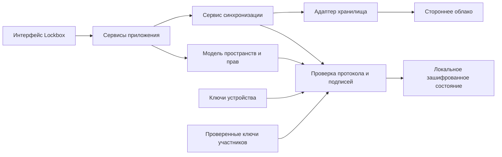
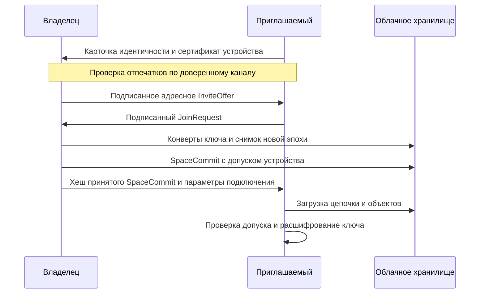

# Lockbox Protocol

Статус: проект для обсуждения. Дата: 31 октября 2026 года.

Lockbox расширяется из локального менеджера паролей в приложение с несколькими
пользователями и пространствами. Участники обмениваются зашифрованными объектами
через стороннее облачное хранилище. Каждый клиент самостоятельно проверяет
личность подписанта, его полномочия и историю изменения состава пространства.

Основное решение: независимые ключи каждого пространства, отдельные ключи
устройств, подписанная последовательность изменений доступа и граф подписанных
изменений данных. Облако отвечает за хранение и доставку объектов. Его ответы
не определяют, кому разрешено читать данные или вносить изменения.

Первая версия протокола ориентирована на личные и небольшие совместные
пространства. Она сохраняет работу без сети и не требует собственного сервера
Lockbox. Управление составом пространства выполняет один назначенный подписант,
а редактирование данных доступно параллельно нескольким устройствам.

## Текущее устройство приложения

В [src/vault.rs](../src/vault.rs) всё содержимое хранилища сериализуется в JSON
и шифруется целиком. Мастер-пароль проходит Argon2id, затем HKDF; содержимое
защищается XChaCha20-Poly1305. Заголовок файла аутентифицируется как associated
data. Формат v2 содержит записи и папки, а v1 поддерживается при чтении.

Сохранение использует временный файл, синхронизацию на диск и переименование.
Состояние интерфейса и операции над данными находятся преимущественно
в [src/app/workspace.rs](../src/app/workspace.rs)
и [src/app/directories.rs](../src/app/directories.rs). Записи и папки уже имеют
случайные устойчивые идентификаторы. Это позволяет добавить версионирование
без привязки к названию, пути папки или позиции в списке.

Сейчас в приложении нет пользовательских идентичностей, общего пространства,
криптографических подписей и сетевой синхронизации. Ключ существующего `.lbx`
подтверждает возможность расшифровать и перезаписать весь файл. Он не позволяет
различить авторов изменений, если один ключ известен нескольким людям.

Существующий локальный режим сохраняется. Настройка облака и публикация данных
выполняются отдельно для выбранных пространств.

## Требования и границы первой версии

### Основные сценарии

- Один пользователь создаёт несколько личных или совместных пространств.
- Пользователь работает с одного или нескольких независимо зарегистрированных
  устройств.
- Владелец приглашает другого пользователя с правом чтения или редактирования.
- Участники создают и изменяют записи и папки без одновременного присутствия
  в сети.
- Клиент проверяет каждое изменение до включения в состояние пространства.
- Владелец отзывает доступ пользователя или отдельного устройства.
- При параллельном изменении пароля приложение сохраняет обе версии.
- Пользователь может экспортировать данные и сменить провайдера хранения.

### Ограничения начального выпуска

Единица доступа — пространство целиком. Внутри пространства все участники
читают все записи. Доступ к отдельным папкам, запрет копирования паролей,
публичные ссылки на отдельные записи и несколько независимых администраторов
не входят в начальный выпуск.

Перенос записи между пространствами выполняется как явное копирование.
Удаление исходной записи — отдельное действие. Общая атомарная транзакция между
двумя пространствами не предполагается.

Приглашение и отзыв доступа требуют доступности управляющего устройства
владельца. Обычное редактирование продолжает работать без него.

Система не обещает мгновенный отзыв доступа по настенным часам у отключённых
клиентов. Граница отзыва задаётся подписанным переходом в новую эпоху ключей.

## Модель доверия

Клиент доверяет локальному приложению, криптографической реализации,
генератору случайных чисел и явно проверенным открытым ключам участников.
Владелец уполномочен изменять состав своего пространства и подтверждать
начальное состояние для новых участников.

Облако может возвращать старые объекты, менять порядок доставки, скрывать
объекты, подменять индексы, повторять запросы и показывать разным участникам
разные истории. Хеши, подписи и шифрование защищают от принятия поддельных
данных. Доступность и полноту выдачи одного провайдера невозможно доказать
только по ответам этого провайдера.

| Угроза | Предлагаемая защита | Существенная граница |
|---|---|---|
| Провайдер читает содержимое | Сквозное шифрование на клиентах | Размеры объектов, время запросов и часть метаданных остаются видимыми |
| Провайдер меняет объект | Проверка хеша, подписи и AEAD | Удаление объекта может остановить синхронизацию |
| Посторонний публикует изменение | Проверка подписи и допуска устройства | Мусорные объекты всё ещё расходуют квоту и трафик |
| Читатель пытается изменить данные | Проверка роли подписанта | Читатель знает ключ расшифрования и может создать AEAD-шифротекст, но это не даёт права записи |
| Удалённый участник продолжает писать | Закрытие старой эпохи и новая выдача ключей | Неосведомлённый клиент может продолжить локальную работу в старой эпохе |
| Подмена ключей при приглашении | Проверка отпечатков по независимому каналу | Самоподписанный ключ не доказывает человеческую личность |
| Участникам показывают разные истории | Сохранённые опорные точки и сравнение историй между клиентами | При полной изоляции через единственное злонамеренное облако обнаружение не гарантируется |
| Злоумышленник управляет разблокированным устройством | Отзыв устройства и смена ключей после обнаружения | Доступные этому устройству секреты считаются раскрытыми |

Различие между аутентичностью сообщений и полнотой доставки существует
и в стандартизированных групповых протоколах: служба доставки может разделить
участников и скрывать сообщения. [RFC 9750, раздел 5.2](https://www.rfc-editor.org/rfc/rfc9750.html#section-5.2).

### Видимые облаку метаданные

В начальном протоколе управляющая цепочка содержит открытые технические
идентичности, роли и сертификаты устройств. Провайдер видит состав этих
псевдонимных участников, частоту смены состава, авторов конвертов изменений,
размеры объектов и обращения к пространству. Повторное использование одного
корневого открытого ключа позволяет связать участие пользователя в нескольких
доступных провайдеру пространствах.

Названия пространств, имена участников для отображения, названия записей,
папки и содержимое транзакций остаются внутри шифрования. Анонимность состава
и отсутствие связи между пространствами потребуют отдельного расширения
с иными идентификаторами и правилами публикации; начальный протокол этого
не обещает.

## Общая схема компонентов



Сетевой адаптер возвращает недоверенные байты. Только слой проверки протокола
может преобразовать их в проверенные объекты. Интерфейс получает готовую модель
пространства, конфликты и понятные состояния синхронизации.

Поддерживаются два вида истории:

1. **История доступа** — последовательная цепочка `SpaceCommit`. Она задаёт
   состав участников, допущенные устройства, роли и смену ключей.
2. **История данных** — ориентированный ациклический граф `Change`. Он допускает
   независимые правки разных устройств и сохраняет причинные зависимости.

В первой версии только одно управляющее устройство пространства выпускает
`SpaceCommit`. Все допущенные устройства редакторов могут выпускать `Change`.

## Предметная модель

| Сущность | Содержание |
|---|---|
| `UserIdentity` | Корневой открытый ключ пользователя и производный `user_id` |
| `DeviceCertificate` | Подписанная корнем пользователя привязка ключей конкретного устройства |
| `Space` | Случайный `space_id`, владелец и начальный доверенный объект |
| `SpaceCommit` | Полный состав пространства, эпоха ключей и ссылка на предшествующий commit |
| `EpochKeyGrant` | Ключ эпохи, зашифрованный для конкретного допущенного устройства |
| `InviteOffer` | Адресное предложение доступа с ролью и опорной точкой пространства |
| `JoinRequest` | Подписанное согласие приглашённого устройства |
| `Change` | Подписанная зашифрованная транзакция над записями и папками |
| `Checkpoint` | Зашифрованное состояние пространства на явно указанной границе истории |
| `TrustedHeads` | Локально сохранённые проверенные вершины истории и управляющей цепочки |
| `Outbox` | Долговечная очередь подготовленных сетевых объектов |

`space_id` генерируется независимо от локального `.lbx`, облачного пути и названия
пространства. Рекомендуемый размер — 32 случайных байта. Папка не может иметь
родителя в другом пространстве. Идентификатор записи рассматривается вместе
с `space_id`.

Папки остаются инструментом организации данных. Если двум наборам записей
нужны разные участники, они размещаются в разных пространствах.

## Пользователи и устройства

### Корневая идентичность

У пользователя есть корневая пара Ed25519. Производный идентификатор:

```text
user_id = SHA256("lockbox.user.v1\0" || user_root_public_key)
```

Имя и адрес электронной почты — отображаемые атрибуты. Они не заменяют ключ
при проверке полномочий. Совпадение имени нового ключа с именем старого
не считается основанием доверять новому ключу.

Корневой секрет не используется для каждой правки. Он нужен для выпуска
сертификатов устройств, восстановления управляющего устройства и явных
операций с владением. Его резервная копия входит в recovery kit. На основном
устройстве допустима отдельная зашифрованная капсула корневого секрета,
открываемая для таких операций; обычные дополнительные устройства её не получают.
Капсула защищается отдельным паролем восстановления и не раскрывается при
обычной разблокировке профиля. Пароль обрабатывается Argon2id с независимой
солью и параметрами, записанными в версии формата капсулы.

### Ключи устройства

Каждое устройство самостоятельно создаёт две независимые пары:

- Ed25519 для подписи изменений и служебных сообщений;
- X25519 для получения ключей через HPKE.

Один секрет не используется одновременно для подписи и обмена ключами.
`device_id` вычисляется из открытого ключа подписи с отдельным постоянным
префиксом. Закрытые ключи повседневной работы не передаются другим устройствам.

Сертификат содержит `user_id`, открытый корневой ключ, `device_id`, оба открытых
ключа устройства, версию протокола и случайный серийный номер. Корень пользователя
подписывает весь сертификат. Устройство дополнительно доказывает владение ключом
подписи в запросе на допуск.

При проверке сертификата `user_id` и `device_id` пересчитываются из указанных
ключей. Совпадение переданной строки идентификатора с записью состава без
совпадения ключей не считается проверкой идентичности.

Корневой сертификат доказывает принадлежность устройства пользователю. Право
работать в конкретном пространстве появляется только после включения точного
хеша сертификата в `SpaceCommit`. Новый сертификат того же пользователя
не получает доступ автоматически.

Для Ed25519 требуется единая строгая проверка, включая отклонение слабых ключей
и некорректных представлений подписей. В Rust подходящий интерфейс предоставляет
`verify_strict`; выбранная версия библиотеки и её настройки фиксируются при
реализации. [Документация ed25519-dalek](https://docs.rs/ed25519-dalek/latest/ed25519_dalek/struct.VerifyingKey.html#method.verify_strict).

## Роли и полномочия

| Действие | Владелец | Редактор | Читатель |
|---|---|---|---|
| Читать записи и копировать секреты | Да | Да | Да |
| Создавать и изменять записи и папки | Да | Да | Нет |
| Удалять данные и разрешать конфликты | Да | Да | Нет |
| Приглашать и удалять участников | Через управляющее устройство | Нет | Нет |
| Менять роли и допускать новые устройства | Через управляющее устройство | Нет | Нет |
| Менять настройки облака для пространства | Через управляющее устройство | Нет | Нет |
| Экспортировать доступные данные | Да | Да | Да |

Роль владельца принадлежит пользователю. Полномочие выпускать очередной
`SpaceCommit` закреплено за одним его управляющим устройством. Другие устройства
владельца могут редактировать данные, но не выпускают конкурирующие изменения
состава.

Любая роль проверяется по истории доступа, на которую ссылается объект.
Проверка подписи без проверки роли недостаточна. Общий симметричный ключ
не используется как доказательство авторства.

## Иерархия ключей и криптографические алгоритмы

| Назначение | Алгоритм и правило |
|---|---|
| Подпись объектов | Ed25519 над сообщением с постоянным префиксом назначения |
| Хеши объектов и идентификаторы | SHA-256 с разделением назначений |
| Доставка ключа устройству | HPKE Base mode с X25519, HKDF-SHA256 и ChaCha20-Poly1305 |
| Шифрование содержимого | XChaCha20-Poly1305 со случайным 24-байтовым nonce |
| Производные симметричные ключи | HKDF-SHA256 с отдельными контекстами |
| Локальная защита профиля | Существующая схема Argon2id и HKDF с версионированием формата |
| Случайность | Генератор операционной системы |

Ed25519 определён в [RFC 8032](https://www.rfc-editor.org/rfc/rfc8032.html).
HPKE применяется через готовую реализацию схемы из
[RFC 9180](https://www.rfc-editor.org/rfc/rfc9180.html), без самостоятельного
конструирования обмена X25519 и шифрования ключа.

Для каждого пространства и каждой эпохи генерируется независимый случайный
32-байтовый `K_epoch`. Следующий ключ не выводится из предыдущего. Удалённый
участник, знающий предыдущий ключ, не должен вычислить следующий.

```text
K_changes = HKDF-SHA256(
    ikm  = K_epoch,
    salt = space_id,
    info = "lockbox.changes.v1\0" || epoch_context
)

K_checkpoint = HKDF-SHA256(
    ikm  = K_epoch,
    salt = space_id,
    info = "lockbox.checkpoint.v1\0" || epoch_context
)
```

`epoch_context` — случайное 32-байтовое значение, подписанное в управляющем
объекте. Контексты ключей, подписей и хешей являются частью протокола и не
заменяются произвольными строками реализации.

Мастер-пароль одного участника не передаётся другим участникам и не определяет
ключ пространства. Изменение локального мастер-пароля переупаковывает локальные
секреты; оно не требует раздавать новый пароль участникам.

Начальная схема с долговременными HPKE-ключами получателей не обеспечивает
forward secrecy относительно последующей компрометации этих ключей: старые
сохранённые конверты могут стать расшифровываемыми. Простое удаление локальной
копии старого ключа эпохи не устраняет этот риск, если сохранился конверт.
[RFC 9180, раздел 9.7.4](https://www.rfc-editor.org/rfc/rfc9180.html#section-9.7.4).

## Представление и подпись объектов

В начальном протоколе предлагается JSON с канонизацией JCS. Обычная
`serde_json::to_vec` сама по себе не является реализацией JCS. Порядок ключей,
числа и строки обрабатываются по
[RFC 8785](https://www.rfc-editor.org/rfc/rfc8785.html).

Правила формата:

- двоичные значения кодируются base64url без padding; хеши в именах файлов —
  строчным hex;
- счётчики и номера эпох передаются десятичными строками без ведущих нулей;
  допустимый диапазон проверяется отдельно;
- ключи JSON не повторяются; неизвестные поля и неподдерживаемые типы в версии
  протокола отклоняются;
- текст не нормализуется после подписи;
- массивы, представляющие множества, сортируются по определённому протоколом
  порядку; дубликаты отклоняются;
- до декодирования больших полей проверяются размеры входного объекта;
- подпись хранится вне подписываемого тела.

```text
signature = Ed25519.Sign(
    device_signing_key,
    "lockbox.change.v1\0" || JCS(change_body)
)

object_id = SHA256(
    "lockbox.object.v1\0" || JCS({ body: change_body, signature: signature })
)
```

Для самостоятельно подписываемых объектов — сертификата, предложения
приглашения, запроса на вступление, управляющего объекта и сетевого указателя —
используются разные постоянные префиксы подписи. Подпись одного типа сообщения
не принимается как подпись другого. Конверты ключей и снимки в этой версии
аутентифицируются включением их хешей в подписанный `SpaceCommit`.

Повторное представление тех же подписанных полей с иными пробелами не создаёт
новый объект: идентификатор вычисляется по каноническим байтам. В хранилище
публикуется каноническое представление.

## Подписанная история доступа

### Содержимое управляющего объекта

Начальный `SpaceCommit` создаёт пространство. Каждый следующий объект содержит:

| Поле | Назначение |
|---|---|
| `protocol_version`, `type` | Версия и назначение сообщения |
| `space_id` | Неизменяемый идентификатор пространства |
| `epoch` | Номер новой эпохи |
| `previous_commit` | Хеш предыдущего управляющего объекта; `null` у начального |
| `epoch_context` | Случайный контекст новой эпохи |
| `owner_user_id` | Текущий владелец пространства |
| `control_device` | Единственный подписант следующего штатного перехода |
| `members` | Полный список пользователей, ролей и хешей допущенных сертификатов |
| `closed_frontier` | Вершины графа изменений закрываемой эпохи |
| `checkpoint_ref` | Хеш снимка состояния для новой эпохи |
| `key_grant_refs` | Хеши конвертов нового ключа для всех допущенных устройств |
| `accepted_invites` | Идентификаторы приглашений, реализованных этим переходом |
| `reason` | Тип перехода, например приглашение, отзыв или смена устройства |

Номер эпохи увеличивается ровно на один, а `previous_commit` должен совпасть
с известной вершиной цепочки. Подписант имеет управляющее полномочие
в предыдущем состоянии. Новый участник не может сам подписать своё включение.

Состав содержит ровно одного владельца. Управляющее устройство принадлежит ему
и входит в список допущенных сертификатов. Пользователи, сертификаты и конверты
не повторяются. Набор получателей нового ключа в точности соответствует набору
допущенных устройств, включая читателей. В начальном объекте
`closed_frontier` пуст; у последующих переходов он относится только
к непосредственно закрываемой эпохе.

Состав меняется только целым проверенным переходом. При любом изменении состава,
ролей или допущенных устройств выпускается новая эпоха и новый случайный ключ.
Это унифицирует обработку отзыва, приглашения и понижения роли.

### Подготовка перехода без циклических ссылок

Сначала управляющее устройство выбирает номер эпохи, `epoch_context` и новый
ключ. Затем создаёт конверты ключа и снимок состояния. Их шифрование привязано
к `space_id`, номеру эпохи и `epoch_context`. Для конверта дополнительно
указываются точный получатель и хеш его сертификата.

После этого управляющий объект включает хеши готовых конвертов и снимка
и подписывается. Обычные изменения данных уже ссылаются на окончательный хеш
этого управляющего объекта. Конверт или снимок не ссылается на хеш объекта,
который сам включает их хеш: так исключается циклическая зависимость.

Подпись `SpaceCommit` аутентифицирует и ссылки на конверты. HPKE Base mode
сам по себе не доказывает, что конверт создал владелец; это доказывает включение
точного конверта в проверенный управляющий объект.

### Единственный управляющий подписант

На управляющем устройстве действует блокировка единственного процесса записи.
До публикации оно сохраняет подписанный переход в долговечный журнал и больше
не подписывает другой переход от того же предшественника.

Два разных корректно подписанных перехода от одного `previous_commit`
считаются развилкой истории управления. Клиент прекращает публикацию новых
данных, сохраняет обе ветви и показывает ошибку безопасности. Выбор по времени,
большему номеру эпохи или порядку выдачи облака запрещён.

Штатная передача управляющего полномочия включается в переход, подписанный
старым управляющим устройством. Новое устройство подтверждает владение своим
ключом. После фиксации старое устройство не выпускает дальнейших переходов.

## Приглашение пользователя

### Проверка ключей до выдачи доступа

Базовый сценарий использует адресное приглашение. Приглашаемый сначала
передаёт карточку идентичности и сертификат устройства. Владелец проверяет
отпечаток корневого ключа через личную встречу, QR-код или уже доверенный канал.
Проверяется полный отпечаток, а не короткий декоративный идентификатор.

Верификация по адресу почты или ответу облачного каталога не заменяет
проверку ключа. Аналогичное требование к привязке идентичности и ключа
рассматривается в [RFC 9750, раздел 8.4.2](https://www.rfc-editor.org/rfc/rfc9750.html#section-8.4.2).

### Последовательность приглашения



`InviteOffer` связывает случайный `invite_id`, `space_id`, хеш начального
управляющего объекта, известную вершину истории, владельца, точного пользователя,
сертификат получателя и предлагаемую роль. Предложение не содержит ключей
пространства. `JoinRequest` ссылается на хеш предложения и подписывается
приглашаемым устройством.

После проверки запроса владелец выпускает новый `SpaceCommit`. Только этот
переход выдаёт доступ. Пересылка ссылки третьему лицу не меняет целевой ключ
и не позволяет ему вступить.

Повторная обработка того же `invite_id` не создаёт новое членство. Управляющее
устройство хранит состояния ожидающих, отменённых и использованных приглашений;
использованные идентификаторы подтверждаются цепочкой управления. Срок действия
предложения проверяется владельцем при обработке запроса и не считается
глобально доверенным доказательством времени.

Обмен предложением и запросом может идти через файл или существующий канал
связи. До допуска пользователь не обязан иметь доступ к общему облаку.
Приглашение через облачный почтовый ящик возможно как дополнительный транспорт
с отдельными ограниченными правами, без изменения криптографического сценария.

По умолчанию новый участник получает текущее состояние и будущие изменения.
Старые ключи эпох ему не выдаются. Предоставление исторических ключей — отдельное
явное расширение доступа: оно раскрывает и прежние значения секретов.

## Формат изменений данных

Один `Change` содержит зашифрованную транзакцию. Она может атомарно изменить
несколько записей и папок, например удалить поддерево папок с переносом записей.
Внешний конверт не раскрывает название записи, её идентификатор и вид действия.

Ниже приведена схема полей, а не готовый объект для подписи:

```text
ChangeBody {
    protocol_version,
    type = "space.change",
    space_id,
    membership_hash,
    epoch,
    author_device,
    device_sequence,
    previous_device_change,
    causal_parents[],
    nonce,
    ciphertext
}
```

`membership_hash` указывает точный `SpaceCommit`, определяющий полномочия
автора и ключ эпохи. `causal_parents` содержит известные автору вершины графа
текущей эпохи. Начальное состояние этой эпохи неявно закреплено её снимком.

Счётчик и цепочка устройства ведутся отдельно для сочетания
`space_id`, `membership_hash`, `device_id`. Первое изменение имеет счётчик `1`
и пустую ссылку на предшественника. Следующее увеличивает счётчик ровно на один.
`previous_device_change` должен быть достижим из `causal_parents` следующего
объекта; одной отдельной ссылки без причинной связи недостаточно. Все такие
родители принадлежат тому же пространству и той же эпохе.
В новой эпохе начинается новая цепочка; это позволяет переносить правки из
закрытой эпохи без продолжения исключённой ветви.

Associated data шифрования — каноническое представление всех полей заголовка
до `ciphertext`, включая nonce и причинные ссылки. Затем подписывается полное
тело с шифротекстом. Подмена автора, пространства, эпохи, зависимостей или nonce
не проходит проверку.

Внутреннее содержимое включает список изменений сущностей:

```text
Transaction {
    mutations: [
        {
            entity_type,
            entity_id,
            base_revisions[],
            action,
            value
        }
    ]
}
```

`action` различает запись нового значения, удаление, явное восстановление
и разрешение конфликта. Одна транзакция не содержит двух изменений одной
сущности. `base_revisions` ссылается на версии, с которыми работал автор.
Все необходимые версии достижимы из заявленных причинных родителей или
начального снимка эпохи.

### Порядок проверки полученного изменения

1. Ограничить размер объекта и выполнить строгий разбор формата.
2. Сопоставить вычисленный идентификатор с запрошенным хешем объекта.
3. Проверить пространство и получить требуемую цепочку управления.
4. Проверить сертификат устройства и его точное включение в состав.
5. Проверить Ed25519-подпись и роль автора в указанном состоянии доступа.
6. Проверить цепочку устройства, отсутствие развилки и причинные зависимости.
7. Применить правила открытой или уже закрытой эпохи.
8. Расшифровать содержимое с проверкой associated data.
9. Проверить схему транзакции и её корректность в заявленном причинном состоянии.
10. Атомарно сохранить объект, обновлённую проекцию и опорные точки.

Отсутствие зависимости переводит объект в ожидание загрузки, а не в применённое
состояние. Ошибка подписи или полномочий не исправляется повторным шифрованием
или игнорированием проблемного поля.

Время создания может храниться внутри зашифрованного содержимого для показа
пользователю. Оно не определяет порядок версий или полномочия автора.

## Параллельные изменения и конфликты

### Детерминированная модель данных

Слой хранения сохраняет проверенное множество изменений. Проекция состояния
вычисляется из этого множества и причинных связей, а не из порядка доставки.
Одинаковый набор объектов должен давать одинаковое состояние на всех клиентах.

Для каждой записи или папки сохраняются все версии, которые не перекрыты
причинно более поздней версией. Две версии, ни одна из которых не следует
из другой, образуют конфликт. В качестве идентификатора версии используется
хеш изменения и индекс изменения сущности в транзакции.

Изменения разных записей объединяются автоматически. Два параллельных изменения
одной записи сохраняются полностью. Поля логина, пароля и TOTP не объединяются
автоматически: сочетание нового пароля с чужим вариантом логина может быть
неверным даже при формально корректных данных.

Разрешение конфликта — новая подписанная транзакция с выбранным значением
и ссылками на все разрешаемые версии. Позднее обнаруженная параллельная версия
может снова создать конфликт.

### Удаление и восстановление

Удаление создаёт tombstone, то есть подписанную версию с признаком удаления.
Оно не стирает доказательства существования записи. Параллельные удаление
и редактирование сохраняются как конфликт. Последующее восстановление должно
явно ссылаться на tombstone; старая операция не воскрешает запись незаметно.

### Структура папок

Удаление папки сохраняет текущую семантику Lockbox: записи переносятся выше,
а удаляемые папки получают tombstone. Все переносы и удаления включаются в одну
транзакцию по известному автору состоянию.

Параллельные действия могут создать цикл папок, одинаковые названия соседей
или ссылку новой записи на уже удалённую папку. Эти ситуации нельзя разрешать
отбрасыванием «последнего пришедшего» объекта: результат зависел бы от сети.

Каждая транзакция проверяется относительно своего причинного состояния.
Противоречие, появившееся только при объединении независимых корректных
транзакций, сохраняется как структурный конфликт. Его идентификатор вычисляется
из отсортированных идентификаторов участвующих версий. Затронутые записи
остаются доступны через список конфликтов и поиск. Интерфейс предлагает
подписанное исправление иерархии, не скрывая секреты из-за отсутствующего пути.

Существующий `folder::validate` сохраняется для обычной редактируемой проекции.
Слой синхронизации дополнительно хранит конфликтные варианты; его нельзя
заменить последовательным вызовом существующей локальной проверки после
каждой сетевой доставки.

## Эпохи и отзыв доступа

### Закрытие предыдущей эпохи

Новая эпоха фиксирует `closed_frontier`: набор вершин графа предыдущей эпохи,
из которого достижимы все включённые в итог операции. Граница содержит хеши,
а не отметку времени. Отсутствие нужного предка означает неполную историю,
которую следует загрузить до полной проверки снимка.

Внутри открытой эпохи изменение может быть корректным и уже видимым, но ещё
не включённым в завершающий снимок владельца. Различаются проверка операции
и её включение в закрытую историю эпохи. Обычная синхронизация не требует
подписи владельца под каждой пользовательской правкой.

### Шаги отзыва

1. Управляющее устройство получает доступную историю и выбирает закрываемую
   границу операций.
2. Удаляет пользователя или устройство из следующего состава.
3. Создаёт независимый ключ новой эпохи.
4. Формирует снимок состояния по выбранной границе, сохраняя конфликты
   и tombstone.
5. Шифрует новый ключ отдельно для каждого оставшегося устройства.
6. Подписывает переход с новой ролью или составом, снимком и конвертами.
7. Публикует зависимости и затем управляющий объект.

Получив переход, клиент перестаёт публиковать изменения в старой эпохе.
Из старой эпохи принимаются только операции в транзитивном замыкании
`closed_frontier`. Поздно поступившая операция вне этой границы сохраняется
в карантине, даже если подпись и прежние полномочия корректны.

### Судьба офлайн правок

Допустим, Мария и Иван работали в эпохе `7`. Владелец исключил Ивана и создал
эпоху `8`. Мария возвращается с офлайн-правками эпохи `7`, не попавшими
в закрываемую границу.

Правки Марии не теряются: клиент переносит их в локальные неподтверждённые
изменения, сравнивает с новым состоянием и, поскольку Мария допущена в эпоху `8`,
создаёт новые подписанные транзакции. Если значения разошлись, требуется
разрешение конфликта. Простое повторное шифрование старых байтов без пересмотра
зависимостей не используется.

Иван не может повторить этот шаг как участник эпохи `8`: у него нет нового
ключа и допуска. Ссылка на прежнюю эпоху или задним числом выставленная дата
не обходят закрывающую границу.

Клиент, уже показавший затем исключённую правку, явно отмечает её как
не вошедшую в переход и сохраняет локальный вариант. Подписанный переход
не должен приводить к незаметной потере пользовательской работы.

### Пределы отзыва

Отзыв не уничтожает ранее раскрытые пароли, TOTP-секреты и экспорты. Для
реального прекращения доступа к внешнему сервису его пароль или TOTP-секрет
может потребоваться сменить в самом сервисе и сохранить новую версию.

Защищены новые данные, зашифрованные в новой эпохе. Пока отключённый клиент
не узнал о переходе, он может создавать данные со старым ключом. Перед отправкой
накопленных правок клиент сначала обновляет историю доступа, однако злонамеренное
облако может скрывать переход. Гарантия немедленного отзыва по реальному времени
потребовала бы дополнительного доверенного источника свежести и ограничения
офлайн-публикации.

## Снимки состояния и доступ к истории

Каждый переход эпохи включает зашифрованный `Checkpoint`. Он содержит текущее
состояние записей и папок, конфликтные варианты, tombstone, границу исходных
операций и версию алгоритма построения проекции. Идентификаторы сущностей
и варианты значений сохраняются при смене эпохи.

Управляющая подпись подтверждает снимок через его точный хеш. Подпись владельца
под снимком не заменяет исходную подпись автора изменения: это разные
утверждения.

У существующего участника при наличии прежних ключей и истории есть возможность
пересчитать состояние по `closed_frontier` и сверить его со снимком. При
несовпадении он фиксирует ошибку безопасности. Если доказательств не хватает,
снимок не получает статус полностью перепроверенного воспроизведением истории.

Новый участник, которому не выданы исторические ключи, принимает начальное
состояние по аттестации владельца. Он не может независимо расшифровать
и воспроизвести всю прежнюю историю. С этого момента он самостоятельно
проверяет новые изменения. Интерфейс аудита различает исходные проверенные
подписи и состояние, принятое из подтверждённого владельцем снимка.

Нельзя одновременно обещать новому участнику отсутствие доступа к старым
значениям и полную независимую проверку всех этих значений через расшифрование
старого журнала. В начальном выпуске выбирается текущее состояние без старых
ключей.

Сборка мусора не входит в первый выпуск. В дальнейшем удаление истории
потребует подписанной политики хранения и явной опорной точки. Объект не
удаляется только потому, что его нет в последней выдаче облачного индекса.
Резервные копии и старые HPKE-конверты учитываются отдельно: удаление одного
объекта не является гарантией криптографического стирания.

## Облачное хранилище и транспорт

### Контракт провайдера

Протокол не зависит от конкретного поставщика. Адаптер предоставляет загрузку
объекта по ключу, публикацию объекта и перечисление доступных ключей с пагинацией.
Условная запись и версии объектов объявляются отдельными возможностями.

```text
get_object(key, size_limit) -> bytes
put_object(key, bytes) -> publication_result
list_objects(prefix, cursor, page_limit) -> page
compare_and_swap(key, expected_version, bytes) -> optional capability
```

`publication_result` означает результат операции провайдера. Криптографическая
корректность объекта проверяется отдельно. Адаптер не выбирает доверенную ветку
истории и не назначает роли.

Для разработки нужен локальный адаптер с управляемыми задержками, потерями
и подменами. Первым сетевым адаптером предлагается S3-совместимое хранилище;
конкретный поставщик выбирается отдельно. Утверждения о поведении Amazon S3
не переносятся автоматически на любой совместимый API.

### Размещение объектов

```text
spaces/<opaque_namespace>/objects/<object_hash>.json
spaces/<opaque_namespace>/hints/control.json
spaces/<opaque_namespace>/hints/devices/<device_id>.json
```

`opaque_namespace` — случайный сетевой идентификатор пространства. Его знание
не является криптографическим разрешением. Объекты под именем хеша неизменяемы
по правилам клиента; скачанные байты всегда сверяются с ожидаемым хешем.

Индексы `hints` служат ускорению поиска. Они содержат подписанные ссылки на
известные вершины, но могут устареть или исчезнуть. У каждого устройства свой
указатель, поэтому несколько редакторов не перезаписывают один общий
изменяемый `vault.lbx`. Для восстановления клиент может перечислить объекты
пространства и проверить их без доверия к подсказкам.

Объекты публикуются от зависимостей к ссылкам: сначала конверты, снимки и
родители, затем ссылающиеся на них объекты, после этого подсказки. Читатель
готов к любому фактическому порядку видимости. Частичная публикация даёт
ожидающий объект, а не частично применённый переход.

Для управляющих подсказок и повторной публикации можно использовать условные
запросы. Amazon S3 описывает `If-None-Match` и `If-Match` в
[документации условных записей](https://docs.aws.amazon.com/AmazonS3/latest/userguide/conditional-writes.html).
Эти операции уменьшают гонки, но не заменяют подписанную историю. `ETag`
не используется как доверенный хеш протокола.

При работе через каталог, синхронизируемый облачным диском, адаптер сначала
пишет временный файл и затем переименовывает его. Дубликаты и конфликтные копии
обрабатываются по содержимому и проверенному хешу. Облачное переименование
не предполагается глобально атомарным.

### Учётные данные провайдера

Полномочия API хранилища и полномочия Lockbox существуют независимо.
Успешный вход в облако не делает устройство участником пространства.

В первом выпуске доступ к провайдеру настраивается через его собственный
механизм: администратор выдаёт ограниченные права конкретному пользователю или
устройству. Автоматическая выдача облачных учётных данных не объявляется
универсальной функцией протокола. У поставщика без нужного механизма такое
подключение потребует ручной настройки или отдельного сервиса выдачи доступа.

Желательно ограничить редактора его пространством, а право менять управляющую
подсказку оставить управляющему устройству. Удаление объектов по возможности
не выдаётся обычным участникам. После отзыва доступ API также отзывается:
это снижает риск удаления, расходования квоты и наблюдения метаданных.

Секреты API не входят в общий снимок пространства, исходный код, открытый JSON
конфигурации или обычную ссылку-приглашение. Они хранятся локально под защитой
профиля или системного хранилища учётных данных. Все сетевые соединения
используют HTTPS, даже при сквозном шифровании объектов.

## Алгоритм синхронизации

### Локальное изменение

1. Приложение проверяет роль и действие в текущей проекции.
2. Создаёт транзакцию, причинные ссылки и следующий номер цепочки устройства.
3. Шифрует и подписывает объект.
4. Сохраняет неизменяемые байты объекта в локальный кеш с синхронизацией на диск.
5. Одной локальной транзакцией обновляет профиль: проекцию, `TrustedHeads`,
   счётчик и ссылку на объект в `Outbox`.
6. Показывает успешное локальное сохранение.
7. Фоновый сервис отправляет ровно эти байты; повтор запроса не выпускает новую
   подпись или новый счётчик.

Падение между шагами 4 и 5 оставляет лишний кешированный объект, который не
считается принятым. Падение после шага 5 сохраняет очередь отправки. Неудача
сети не откатывает локальную правку.

### Сеанс обмена

1. Получить подсказки и доступные управляющие объекты.
2. Проверить продолжение истории доступа от локально закреплённой точки.
3. Применить смену эпохи или зафиксировать обнаруженную развилку.
4. Загрузить требуемые конверты, снимки и зависимости с ограничением ресурсов.
5. Получить новые изменения данных и проверить каждое по правилам протокола.
6. Построить новую проекцию и сохранить её вместе с опорными точками атомарно.
7. Перенести исключённые старые правки в обработку повторного применения.
8. Отправить допустимую очередь текущей эпохи.
9. Опубликовать собственную подписанную подсказку.

Ошибка одного пространства не блокирует синхронизацию остальных. Повторные
попытки используют увеличивающуюся задержку и случайный разброс. Ошибка сети,
отсутствующая зависимость, конфликт данных и ошибка криптографической проверки
имеют разные состояния и способы восстановления.

Подтверждение загрузки объекта провайдером означает доставку в это хранилище.
Оно не доказывает получение всеми участниками и не превращает открытый граф
в глобально согласованный журнал.

## Защита от отката и разделения истории

Локально сохраняются начальный доверенный хеш пространства, последняя принятая
вершина управляющей цепочки, вершины данных и сведения о выпущенных собственных
подписях. Новая выдача облака не может заменить их более старым состоянием.
Известные локально объекты не исчезают из проекции из-за неполного сетевого списка.

Переход к новой эпохе должен продолжать известную управляющую цепочку.
Больший счётчик без проверяемой связи не является доказательством актуальности.
Первая загрузка нового устройства получает опорную точку из проверенного
приглашения или с уже доверенного устройства, а не только из облачного `latest`.

Для сравнения историй устройства могут выпускать подписанные сообщения
`HeadObservation` с пространством, вершиной управляющей цепочки и известными
вершинами данных. Обмен через то же облако помогает при случайных расхождениях,
но не гарантирует обнаружение намеренной изоляции. Для такой гарантии нужен
независимый канал сравнения или отдельный доверенный свидетель.

В первой версии интерфейс показывает отпечаток подтверждённой истории
для ручного сравнения. Автоматический свидетель остаётся расширением,
не обязательным условием локального режима.

Отдельная сохранённая опорная запись в системном хранилище помогает обнаружить
восстановление старой локальной копии `.lbx`. Обычный Keychain не объявляется
неоткатываемым аппаратным счётчиком. Полное восстановление старого состояния
компьютера вместе со всеми опорными записями требует внешней сверки истории.

## Локальное хранение и жизненный цикл секретов

### Формат локального профиля

Предлагается формат `.lbx` v3 с зашифрованным профилем:

```text
ProfilePayload {
    schema_version,
    public_user_identity,
    local_device_secrets,
    optional_protected_root_capsule,
    spaces: [
        {
            space_id,
            pinned_genesis,
            verified_control_head,
            admitted_device_certificates,
            epoch_keys,
            materialized_state,
            conflict_state,
            trusted_heads,
            signing_counters,
            outbox_refs,
            provider_configuration
        }
    ]
}
```

Кеш подписанных объектов хранится отдельно в виде уже зашифрованных сетевых
конвертов. Он адресуется только проверенными хешами. Запись локального профиля
атомарно фиксирует ссылки, состояние и очередь. Это сохраняет понятную модель
сохранения текущего приложения и не требует сразу вводить отдельную базу данных.
Стоимость полной перезаписи профиля измеряется до увеличения масштаба.

Незашифрованный [src/config.rs](../src/config.rs) продолжает хранить только
несекретные настройки: пути, внешний вид и признаки доступных механизмов
разблокировки. Названия пространств, участники, ключи, токены провайдера
и очередь изменений туда не попадают.

### Блокировка приложения

При блокировке уничтожаются расшифрованная проекция, черновики, симметричные
ключи и активные закрытые ключи в управляемой памяти. Фоновая работа,
которой нужны эти секреты, прекращается. Поздно завершившаяся задача не может
вернуть расшифрованные данные в новую или заблокированную сессию: результат
сопоставляется с поколением сессии.

В начальном выпуске сетевой обмен при блокировке приостанавливается целиком.
Передача готовых зашифрованных объектов без доступа к ключам может появиться
позже как отдельно проверяемый режим.

Сохраняется существующее ограничение WebView: стирание Rust-структур не
гарантирует стирание всех копий текста в DOM и виртуальном DOM. Существующий
Touch ID также не переописывается как аппаратная защита подписывающего ключа:
его текущие ограничения документированы в [README](../README.md#touch-id).

### Параллельные процессы и резервные копии

Для одного локального профиля разрешён один процесс записи. Второй экземпляр
не подписывает изменения тем же ключом и счётчиком. Счётчик сохраняется вместе
с точными байтами выпущенного объекта до его отправки.

При явном импорте резервной копии на другое устройство генерируются новые
ключи устройства и выполняется новый допуск. Резервная копия не превращается
в незаметный клон действующего подписанта. Если обнаружено расхождение
с сохранёнными сведениями о ранее выпущенных подписях, публикация останавливается
до восстановления истории или регистрации нового устройства.

## Восстановление и компрометация

| Ситуация | Порядок действий |
|---|---|
| Потерян мастер-пароль, есть разблокируемое доверенное устройство | Экспорт или перепаковка локального профиля по явно подтверждённой процедуре |
| Потеряно обычное устройство | Владелец пространства исключает его сертификат и выпускает новую эпоху |
| Пользователь добавляет новый компьютер | Новый компьютер создаёт свои ключи, получает сертификат пользователя и отдельный допуск в каждое пространство |
| Потеряно управляющее устройство владельца | Восстановление через корневой ключ владельца и проверенную последнюю опорную точку |
| Потерян корневой секрет, устройства ещё работают | Данные остаются доступны этим устройствам; выпуск новых сертификатов и корневое восстановление могут стать невозможны |
| Украден корневой секрет обычного участника | Новая идентичность проверяется заново; владельцы соответствующих пространств отзывают старую и допускают новую |
| Скомпрометирован корень владельца | Требуется заранее настроенный независимый механизм восстановления либо создание нового пространства и повторная проверка участников |
| Потеряны все ключи и recovery kit | Облако не может восстановить содержимое |

`RecoveryCommit` — отдельный тип перехода, разрешённый корневым ключом
текущего владельца. Он ссылается на проверенную вершину управляющей истории,
назначает новое управляющее устройство и меняет ключ эпохи. Его полномочие
и формат определяются заранее, а не выводятся из доступа к облачному аккаунту.

Если recovery kit знает только старую вершину и возникает конкурирующая ветка,
автоматический выбор запрещён. Нужна сверка с оставшимися доверенными
устройствами. Старый владелец не может применить свой корень к цепочке,
в которой уже проверена передача владения другому пользователю.

Штатная передача владения требует подписанного перехода текущего управляющего
устройства и подтверждений старого и нового корневых ключей. Этот сценарий
может быть отложен за пределы начального интерфейса, но не должен реализовываться
сменой строки `owner_user_id` без доказательств.

Recovery kit хранит корневой секрет, публичную идентичность и проверенные
опорные данные. Сам по себе корневой ключ не расшифровывает старые ключи
пространств. Для восстановления содержимого нужен зашифрованный резервный
экспорт ключей либо повторная выдача актуального доступа существующим
уполномоченным участником. Возможность такого восстановления должна проверяться
отдельным сценарием, а не предполагаться из наличия корневой подписи.

## Разделение Rust модулей

Предлагаемая структура отделяет криптографический протокол от Dioxus и сети:

```text
src/
  identity/
    user.rs           корневая идентичность
    device.rs         сертификаты и допуск устройств
    recovery.rs       восстановление и резервные экспорты
  crypto/
    signing.rs        подпись и строгая проверка
    envelopes.rs      HPKE конверты
    content.rs        AEAD и HKDF
  protocol/
    encoding.rs       строгий JSON и JCS
    objects.rs        версии и типы сетевых объектов
    validation.rs     проверка цепочек и зависимостей
  space/
    membership.rs     роли и переходы эпох
    changes.rs        транзакции и причинный граф
    projection.rs     детерминированная проекция
    conflicts.rs      конфликты записей и иерархии
    checkpoints.rs    снимки и воспроизведение истории
  storage/
    profile.rs        зашифрованный локальный профиль
    object_cache.rs   кеш проверяемых конвертов
    outbox.rs         очередь публикации
    anchors.rs        локальные опорные точки
  sync/
    engine.rs         обмен и повторы
    transport.rs      контракт провайдера
    local.rs          локальный адаптер
    s3.rs             первый сетевой адаптер
  app/
    spaces.rs         действия пользователя над пространствами
    sharing.rs        приглашения и допуск
    sync_status.rs    состояния для интерфейса
    ui/               компоненты Dioxus
```

Это направления ответственности, а не требование сразу создать все файлы.
Небольшие связанные типы допустимо держать вместе до появления достаточной
сложности.

Основные типы границы доверия: `UntrustedObject`, `VerifiedSpaceCommit`,
`VerifiedChange`, `EpochKey`, `LocalDevice` и `SpaceProjection`. Сетевой код
не конструирует проверенный объект напрямую. Закрытые ключи и расшифрованные
значения не получают обычный `Debug`; чувствительные буферы стираются при
освобождении там, где это контролирует Rust.

Операции `save_draft`, удаления записи и изменения папок обращаются к сервису
пространства. Он формирует локальную транзакцию и обновляет профиль. Компоненты
не запускают HPKE, не выбирают доверенную историю и не пишут облачные объекты.

Подключение нескольких администраторов в будущем потребует нового правила
упорядочивания управляющих переходов: например согласованного секвенсора или
кворума. Один лишь CAS конкретного провайдера не становится криптографическим
доказательством общего согласия при злонамеренном провайдере.

## Миграция существующих хранилищ

1. Открыть v1 или v2 существующим путём и проверить содержимое.
2. Создать пользовательскую идентичность и ключи текущего устройства.
3. Создать локальное пространство «Личное» и перенести записи и папки,
   сохранив их идентификаторы.
4. Сформировать начальную опорную точку и записать профиль v3 атомарно.
5. Оставить резервную копию предыдущего файла до проверки повторного открытия.
6. Предложить отдельное включение облака для выбранного пространства.

Новый номер файлового формата обязателен: старый клиент должен отказаться
от перезаписи профиля с неизвестными полями, а не удалить идентичность,
ключи и сведения о пространстве. Версия `.lbx`, версия сетевого протокола
и версия алгоритма проекции ведутся раздельно.

Миграция не выполняет сетевые запросы и не публикует личное пространство
автоматически. Добавление записи в совместное пространство — явное действие,
при котором интерфейс показывает, кому оно доступно.

## Интерфейс и наблюдаемость

В боковой панели появляется переключение пространств. Рядом с названием
доступны участники и роль текущего пользователя. Папки и поиск работают
в выбранном пространстве; общепространственный поиск можно добавить позже
с явным указанием источника результата.

Основные состояния синхронизации:

| Состояние | Что видит пользователь |
|---|---|
| Локальное пространство | Облако не подключено |
| Ожидает отправки | Изменения сохранены на устройстве |
| Синхронизация | Идёт обмен |
| Синхронизировано | Последний обмен успешно завершён по полученной истории |
| Нет сети | Данные доступны локально, отправка продолжится позже |
| Есть конфликт | Требуется выбрать или отредактировать сохранённые варианты |
| Ожидается подтверждение доступа | Предложение ещё не оформлено переходом владельца |
| Доступ отозван | Новые изменения в пространство не публикуются |
| Не удалось проверить историю | Публикация приостановлена, сохранённые данные доступны |

В обычном потоке не показываются хеши, AEAD и детали графа. Для диагностики
и сравнения истории предусмотрен отдельный экран с отпечатками и проверенными
событиями доступа. Надпись «Синхронизировано» не означает доказанное отсутствие
скрытых провайдером объектов или подтверждение получения всеми участниками.

Журналы содержат коды ошибок и при необходимости сокращённые технические
идентификаторы. Пароли, TOTP, названия записей, токены API, приглашения и
закрытые ключи не пишутся в логи, телеметрию или сообщения паники. Диагностический
экспорт по умолчанию включает зашифрованные конверты и результаты проверок.

## Проверка корректности и безопасности

### Инварианты протокола

- Применённое изменение имеет корректную подпись допущенного устройства
  с правом редактирования в соответствующей эпохе.
- Ни один непроверенный байтовый объект не попадает в пользовательскую проекцию.
- Смена пространства, эпохи, автора или зависимости разрушает проверку объекта.
- После закрытия эпохи новая операция вне её зафиксированной границы не
  включается в состояние под видом старой правки.
- Повторная доставка не меняет результат и не увеличивает число версий.
- Одинаковое множество проверенных операций даёт одинаковую проекцию
  независимо от порядка доставки.
- Конкурирующая версия пароля не теряется без подписанного разрешения.
- Сетевой сбой не отменяет успешно сохранённую локальную правку.
- Подписывающий счётчик не откатывается при обычном перезапуске или повторе
  публикации.

### Обязательные группы проверок

| Группа | Сценарии |
|---|---|
| Криптография и кодирование | Официальные тестовые векторы, слабые ключи, некорректные подписи, перестановка полей, дубликаты JSON, разные представления чисел |
| Приглашения | Подмена получателя и роли, повтор запроса, отменённое предложение, новый сертификат того же пользователя без допуска |
| Управление | Переход от неизвестного предка, два преемника, неуправляющий подписант, подмена конверта или снимка |
| Отзыв | Пользователь и отдельное устройство, понижение роли, поздние офлайн-правки, попытка датировать изменение задним числом |
| Сходимость | Случайные перестановки, повторы, задержки зависимостей, одинаковая проекция на нескольких клиентах |
| Конфликты | Два пароля, удаление и правка, восстановление, цикл папок, совпадение имён, новая запись в удалённой папке |
| Сбои | Завершение процесса после каждого шага записи, частичная публикация, потерянная подсказка, перезапуск с непустым Outbox |
| Восстановление | Импорт старой копии, новый компьютер, потеря управляющего устройства, устаревшая опорная точка recovery kit |
| Ограничение ресурсов | Большой JSON, слишком много родителей, длинная цепочка зависимостей, заполнение квоты и бесконечная пагинация |
| Блокировка | Завершение фонового запроса после блокировки, смена профиля во время обмена, отсутствие секретов в журнале |

Property-based тесты проверяют сходимость и идемпотентность, фаззинг — декодер
и валидатор недоверенных объектов. Интеграционные тесты используют несколько
клиентов с управляемым злонамеренным транспортом. До выпуска совместного
хранения реальных секретов требуется независимый разбор протокола и реализации
границы допуска. Проверка только успешного сценария «пригласить и скачать»
не подтверждает свойства отзыва и сходимости.

Начальные ограничения входа фиксируются в версии протокола. Кандидаты для
первого профиля: объект до 4 МиБ, до 64 причинных родителей, до 256 изменений
сущностей в одной транзакции и глубина JSON до 32. Большая причинная граница
сворачивается через обычные подписанные операции объединения зависимостей;
их пустое содержимое не изменяет записи. Снимки большего размера потребуют
манифеста из ограниченных частей до допуска таких пространств. Точные пределы
подтверждаются нагрузочными измерениями и межклиентскими тестами.

Массовое действие, например удаление большого поддерева, не разбивается
незаметно на независимые транзакции: это изменило бы его атомарность. Если
действие превышает принятый предел, начальный интерфейс сообщает об ограничении.
Поддержка больших атомарных действий потребует отдельного манифеста транзакции.

## Этапы реализации

| Этап | Результат | Критерий завершения |
|---|---|---|
| Модель протокола | Форматы, инварианты, точные правила проекции и тестовые векторы | Сценарии приглашения, развилки и отзыва воспроизводятся без интерфейса и облака |
| Идентичности и профиль | Пользователь, устройство, локальный v3, миграция и резервный экспорт | Повторное открытие и восстановление не клонируют подписанта и не теряют записи |
| Пространства и доступ | Управляющая цепочка, конверты ключей, приглашения и ротация | Два клиента проверяют доступ и недопустимые переходы на локальном транспорте |
| Изменения данных | Подписанные транзакции, граф, конфликты, снимки и Outbox | Тесты перестановок и сбоев сохраняют одинаковое состояние и все варианты секретов |
| Облачный адаптер | Один выбранный провайдер и настройка его доступа | Несколько устройств восстанавливают обмен после обрыва и частичной публикации |
| Интерфейс совместной работы | Пространства, участники, приглашения и разрешение конфликтов | Пользователь завершает полный сценарий без ручного редактирования файлов |
| Проверка перед выпуском | Разбор протокола, фаззинг и воспроизводимые сборки | Закрыты замечания, влияющие на доступ, целостность и сохранность данных |

Каждый этап сохраняет рабочий локальный режим. Поддержка нового провайдера
добавляется через транспорт после проверки протокола, не через альтернативную
логику доверия.

## Альтернативы и решения перед реализацией

### Общий зашифрованный файл

Синхронизация одного `.lbx` с общим паролем проста, но не даёт независимого
отзыва устройства, проверяемого авторства и безопасного объединения параллельных
правок. Она не удовлетворяет модели совместных пространств.

### Только подписи без шифрования

Подпись защищает авторство и целостность, но оставляет содержимое доступным
провайдеру. Для менеджера паролей требуется сочетание шифрования, подписи
и проверки полномочий.

### MLS для управления группой

[MLS из RFC 9420](https://www.rfc-editor.org/rfc/rfc9420.html) предоставляет
асинхронное групповое согласование ключей с forward secrecy и post-compromise
security. Его стоит выбирать, если эти свойства являются обязательным
требованием к первой версии или предполагается существенное увеличение групп.

Предложенная начальная схема с индивидуальными HPKE-конвертами проще сочетается
с долговечными снимками и явно сохраняемой историей секретов. Цена — линейное
число конвертов при смене состава и отсутствие названных гарантий MLS.
Это протокол приложения поверх стандартных примитивов, а не реализация MLS
и не эквивалент его доказанных свойств.

Переход на MLS не отменит модель ролей, идентификацию пользователей,
детерминированное разрешение конфликтов и требования к доставке. Сохранение
исторических секретов и восстановление из резервных копий также потребует
отдельной политики.

### Решения для первого выпуска

Предлагаемые значения по умолчанию:

- единица разграничения доступа — пространство;
- роли — владелец, редактор и читатель;
- один управляющий подписант пространства;
- индивидуальные HPKE-конверты ключа каждой эпохи;
- новый участник получает текущее состояние и будущие правки;
- история сохраняется без автоматического удаления;
- синхронизация при блокировке приостанавливается;
- первый сетевой адаптер — S3-совместимый, без обязательного собственного сервера.

До начала сетевой реализации нужно выбрать конкретного провайдера и способ
выдачи его прав участникам. До фиксации криптографического профиля — решить,
нужны ли гарантии MLS уже в первом выпуске. До выпуска многопользовательского
интерфейса — проверить процедуру восстановления корня, ключей содержимого
и управляющего устройства как один завершённый пользовательский сценарий.
