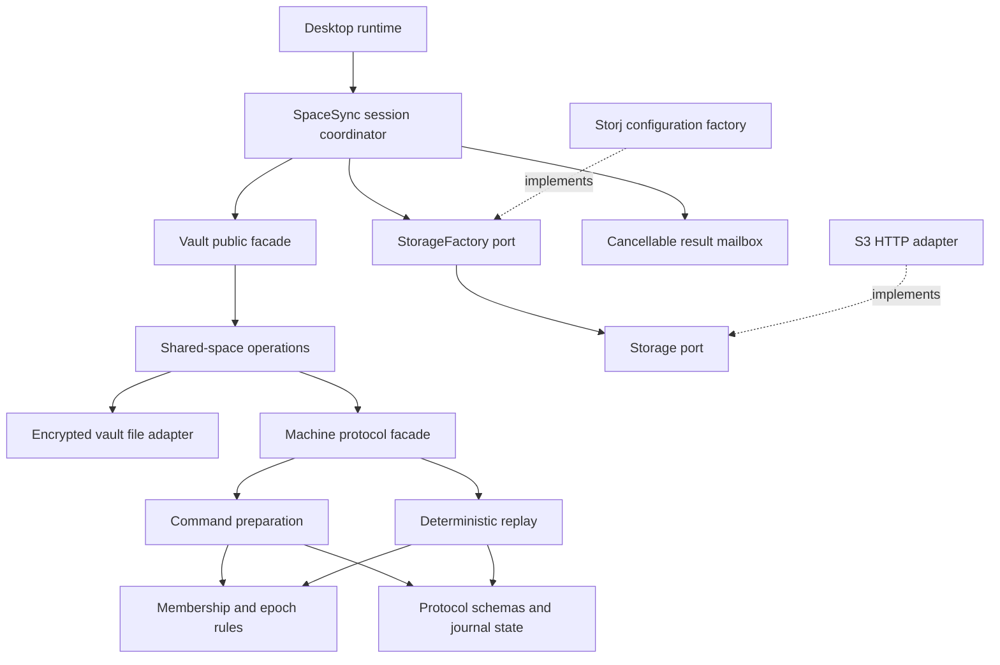

# Synchronization architecture and extension guide

The synchronization engine keeps the `Machine` and `Vault` facades while
separating protocol rules, durable storage, transport construction and session
scheduling. The experimental `LBX-SYNC-0` wire schema and local profile format
are unchanged by this refactor. See [sync-engine.md](sync-engine.md) for protocol
behavior, limits and outstanding release work.

## Responsibilities and dependencies



| Module | Owns | Does not decide |
| --- | --- | --- |
| `core/sync/machine/protocol.rs` | Signed body schemas and immutable dependency references | Signature authority or network behavior |
| `core/sync/machine/state.rs` | Serialized ciphertext journal, trust anchors, replay result contracts | Persistence or automatic recovery |
| `core/sync/machine/commands.rs` | Command validation, encryption, reserved-intent completion | When the host has durably saved a body |
| `core/sync/machine/membership.rs` | Owner authority, certificates, rosters, grants and epoch checkpoints | Provider permissions or discovery |
| `core/sync/machine/replay.rs` | Verified history, epoch closure, causal validation and projection | Disk writes or timestamp winners |
| `infra/vault.rs` | Encrypted file format, KDF, process lock, atomic replacement | Membership and mutation authorization |
| `infra/vault/shared.rs` | Application operations and the durable signing-intent boundary | Alternate protocol rules |
| `infra/vault/exchange.rs` | Candidate receive commits, acknowledgement rollback and retained pending commits | Signing new local mutations |
| `infra/sync.rs` | Bounded discovery, publication order and provider contracts | Which decrypted mutation is authorized |
| `infra/sync/worker.rs` | Thread lifetime, cancellation and one result mailbox | Session status, retries or vault access |
| `infra/storj.rs` | S3 request signing, HTTPS, provider configuration and client construction | User identity or space membership |
| `app/space_sync.rs` | Exchange phases, draft deferral, retry scheduling and status | HTTP construction, signing keys or cryptographic replay |
| `app/space_sync/schedule.rs` | Monotonic deadlines and backoff from explicit clock/jitter inputs | Provider errors or protocol authority |

The smaller modules are private implementation details. Existing callers still
use `core::sync::Machine`, `core::sync::SyncState`, `infra::vault::Vault`, and the
compatibility exports in `lib.rs`. Methods implemented in private modules remain
available on those public facades.

## Applying SOLID to the actual boundaries

**Single responsibility.** Schemas, membership authority, replay, file encryption
and session execution have separate modules. `Vault::commit_prepared` is the one
place shared operations reserve an encrypted body, persist it, and complete the
same intent. Adding an application operation must reuse that boundary.

**Open for extension.** `SpaceSync` accepts an optional `Arc<dyn StorageFactory>`.
Adding a provider or an adversarial test adapter requires implementing the
transport contracts, rather than editing the exchange controller or protocol.
Default provider composition lives in `Vault::storage_factory` in infrastructure.

**Substitution.** Every provider must preserve complete-object addressing,
idempotent uploads, bounded reads and opaque pagination. Neither listing order
nor an ETag can stand in for signature verification. An implementation may report
unavailability or denial, but neither means membership revocation. The application
tests exercise complete exchange and retry through a memory-only factory.

**Interface segregation.** `Storage` describes object exchange. `StorageFactory`
only constructs a blocking adapter on the calling worker thread. The worker
accepts a task and exposes completion; it has no storage or cryptographic methods.
The existing synchronous `Storage` contract remains usable without requiring
every implementation to be `Send`; factories used by workers return `Send`
adapters explicitly.

**Dependency inversion.** The application coordinator depends on transport
contracts. It does not import or construct `Storj`. Credentials enter a concrete
factory at the infrastructure composition boundary; the controller passes only
the factory, namespace, hashes and ciphertext into workers.

## Durable operations and failure handling

Use `Vault::save_changes` for entry/folder edits. Its shared-space implementation
turns staged records into a transaction, restores the current verified view, and
passes the prepared encrypted body to `commit_prepared`.

The ordering is:

1. Validate and prepare one exact encrypted body without signing.
2. Store that body as `SyncState::intent` and persist the encrypted profile.
3. Complete the same intent with a deterministic signature.
4. Persist the accepted event, materialized view and outbox together.
5. Authorize transport publication only from the committed outbox.

Membership changes, resolution, rebase and legacy activation share the same
path. A failed persistence call retains the reserved intent/event so restart or
retry cannot replace it with another body in the same sequence slot. File-format
code calls `recover_sync` on open; the caller never receives an unlocked profile
whose recoverable intent was silently discarded.

`Machine::replay` is pure. A non-ready `Replay` must not replace the last readable
snapshot or authorize publication. A verified history fork is persisted as a
fault with its evidence; connectivity does not clear it. Invalid candidates,
missing dependencies and provider failures remain distinct classifications.

Incoming history is verified as a separate candidate. If its file commit fails,
the committed journal and readable records are restored, while a private
`PendingExchange` retains the candidate and any ready view. Writes, acknowledgements
and publication stay blocked until that same candidate commits successfully.
This prevents a known membership successor from being forgotten and followed by
old-epoch uploads after a disk error. Pending state is held in the unlocked
session, not a new serialized profile field; an independent rollback anchor is
still outside this implementation.

Acknowledgement rollback retains only the previous outbox and exchange time. It
does not clone the immutable ciphertext cache. Publication planning decodes each
eligible object once, then orders it using dependency counts rather than repeated
JSON decoding and full-set scans.

`SpaceSync` follows download, verify-and-commit, upload, then acknowledge. Its
phase handlers cannot directly sign an object or mutate accepted protocol state.
Downloaded results wait while a draft is active, preserving its causal context.
Worker outcomes contain one typed transport result, and one error handler chooses
retry, incomplete history or a frozen session. Upload acknowledgements and the
last-successful-exchange time are committed only after fresh replay and a valid
publication plan; a verification failure cannot become `Synced`.

Replies are bound to the space ID, namespace and pinned genesis that started the
job. Changing that scope discards the old mailbox. The runtime observes persisted
faults and pending commits even while a request is running, so it can cancel old
work promptly. Verified history faults also remain frozen after a retry request
or an attempted local save. `Error::is_history_fault` defines that policy once.

Retry scheduling takes monotonic time and a jitter byte as explicit inputs. Its
tests advance time directly, without sleeping or relying on network timing.

## Extending transport

Implement `infra::sync::Storage` for a new provider and
`infra::sync::StorageFactory` for its configuration/client construction:

- `connect` runs on a worker, returns `Box<dyn Storage + Send>`, and contains no
  vault handle, signing key, HPKE secret, content key or decrypted projection.
- `list` returns bounded pages and opaque continuation tokens. Omission never
  removes an object from the local journal.
- `get` and `put` preserve exact immutable bytes. Keep I/O bounded by time and
  response size. Protocol verification still happens in the core, regardless of
  any checks the adapter performs itself.
- Pass the factory to `SpaceSync::new(Some(factory))` inside the application.
  `None` selects infrastructure's configured factory. Standalone synchronous
  callers can continue using `Vault::synchronize(&mut dyn Storage)`.

Dropping the session drops its worker and cancels subsequent requests. A request
already started can finish under its provider timeout. The worker suppresses a
late result and owns no callback capable of reopening a vault or restoring a
plaintext UI. A provider panic becomes a worker failure and follows normal
transport retry handling.

## Where to change a rule

| Change | Primary module | Regression coverage |
| --- | --- | --- |
| New mutation or conflict semantics | `model.rs` and command/replay validation | Delivery permutations, complete revision bases, atomicity |
| Admission, role or epoch closure rule | `machine/membership.rs` and `machine/replay.rs` | Reader forgery, revocation, forks, checkpoint comparison |
| New wire field or signature binding | `machine/protocol.rs`, `wire.rs`, `crypto.rs` | Canonical wire fixture and signature/hash tests; explicit protocol version decision |
| Crash/durability behavior | `infra/vault/shared.rs`, `infra/vault/exchange.rs` and file adapter | Intent restart, failed candidate/receipt writes, revocation commit failure, legacy activation |
| New provider | `Storage` / `StorageFactory` implementation | Lost responses, partial visibility, pagination and bounded bodies |
| Retry policy or session lifecycle | `app/space_sync.rs`, `schedule.rs`, `infra/sync/worker.rs` | Explicit-time backoff, scope changes, faults during pending work, cancellation and late receipts |

## Verification and fixtures

Run from `scripts/lockbox`:

```sh
cargo test --locked --all-targets
cargo test --locked --doc
cargo run --locked --example shared_space
RUSTDOCFLAGS="-D rustdoc::broken_intra_doc_links" cargo doc --locked --no-deps --document-private-items
```

The S3 HTTP fixture binds to loopback; a sandbox may require permission for that
local socket. The other transport tests use in-memory adapters and do not require
credentials or a live Storj bucket.

`src/core/sync/fixtures/change-v0.json` was captured before the module extraction.
It contains a deterministic signature over public test metadata and opaque test
ciphertext bytes. `change_wire_contract_survives_internal_refactors` checks exact
canonical bytes, the fixed complete-object hash, decoding and strict signature
verification. It does not claim that the opaque ciphertext is a decryptable
transaction; separate tests cover AEAD and mutation authorization.

Do not regenerate that fixture merely to make a refactor pass. A mismatch means
the wire contract changed and needs an explicit compatibility decision. Existing
profile, revocation, crash-recovery and two-client tests remain the behavioral
reference for this implementation.
