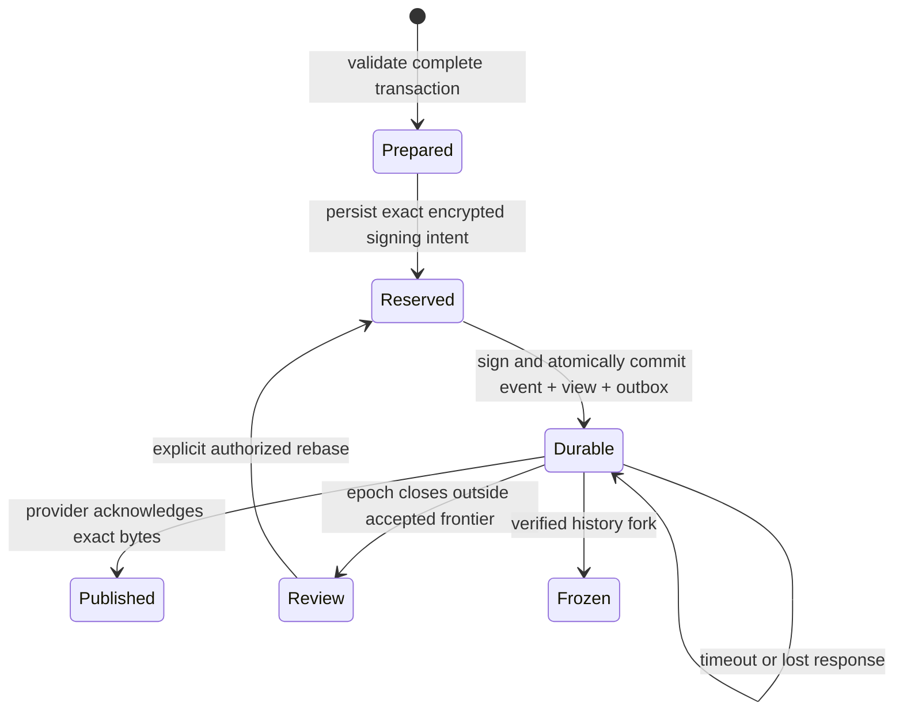

# Shared-space synchronization engine

New spaces use experimental **LBX-SYNC-2**; existing **LBX-SYNC-0/1** histories
remain supported. Profile 1 adds signed recipient consent; profile 2 adds
[controller transfer and recovery](sync-control-recovery.md). It implements
the deterministic event model from [the proposal](lockbox-protocol.md), with a
smaller, separately versioned wire schema. It does not claim proposal-v1
interoperability or a completed security review.

For module ownership, dependency direction, provider extension and durability
contracts, see the [synchronization architecture guide](sync-architecture.md).
The [production delivery plan](sync-production-plan.md) tracks remaining release
gates; the [live test guide](sync-live-test.md) describes reproducible Storj checks.
See [profile protection and recovery](profile-protection.md) for installation
binding, file/witness ordering, read-only imports and fresh-device admission.

## Responsibilities

Protocol rules and replay live in `core/sync`; durable operations and provider
adapters in `infra`; session coordination in `app/space_sync`. The
[architecture guide](sync-architecture.md#responsibilities-and-dependencies)
owns the detailed module map and extension contracts.

Core replay has no network, filesystem, clock or UI dependency. Network timing,
wall-clock time, listing order and random retry jitter never choose a record
version, establish authority or remove known history.

## Local save and exchange



New cloud profiles include a root-signed device certificate and signed empty
genesis. Every entry edit, deletion, folder edit and subtree deletion uses one
transaction. `Vault::save_changes()` reserves its unsigned encrypted body on disk
before signing, then commits the signed object, materialized local records and
outbox inside the encrypted `.lbx`. The UI confirms saving after that commit;
provider availability is not required. `Vault::save()` rejects shared record
changes that bypass the journal.

Each protected file commit advances an independent installation witness. Missing
or inconsistent evidence leaves saved records readable and stops signing/exchange.
Exactly one linked file generation ahead can reconcile after a crash. Copies at
different paths share one installation-wide signer lease.

Restart completes the same reserved body using deterministic Ed25519 signatures.
A failed save retains that intent rather than allocating another sequence slot.
Recovery successfully persists a retained intent before signing, including when
its first reservation write failed and the intent exists only in memory. A failed
core intent completion leaves the original journal and intent intact.
Uploads always reuse exact content-addressed bytes. Object acknowledgement is
persisted separately; losing that acknowledgement causes an idempotent retry.

An exchange scans the namespace without relying on order, verifies received
history, commits it locally, and only then publishes eligible dependencies and
events. Provider omission never deletes a local object. Missing dependencies
pause publication and retain the previous readable view. A verified control
successor stops obsolete epoch publication even if its closed history is missing.
Discovery directly fetches pinned genesis, outstanding local dependencies and
the bounded ancestors of newly downloaded objects, even when LIST omits them.
Unavailable direct references remain incomplete and are retried on later passes.

The desktop worker receives provider credentials, namespace, hashes and
ciphertext. Signing keys, HPKE secrets and decrypted records stay in the session.
Downloaded results wait while an entry or folder draft is active, preserving the
draft's causal context. Locking or switching profiles drops the worker receiver
and cancels subsequent requests; late results cannot restore an unlocked view.
An already started HTTP request may finish, bounded by its timeout.

## Membership and validation

The descriptor pins the complete owner root public key, space ID, genesis hash
and random storage namespace. Compare those values through an authenticated
channel before joining. Display names and provider access are separate from
cryptographic authority.

Each device has an independent root-certified Ed25519 signing key and HPKE
X25519 key. The owner's control device signs the complete next device roster.
The engine verifies certificates, user/device fingerprint derivation, one owner
identity, consistent user roles, exact admitted devices and prior control
authority. Readers receive content keys but cannot publish mutations or causal
merge events.

Each membership transition generates an independent epoch key and context,
delivers the key with RFC 9180 HPKE Base mode (X25519/HKDF-SHA256/
ChaCha20-Poly1305), and encrypts the full baseline with a separately derived
checkpoint key. Signed control bytes bind the roster, grants, baseline,
predecessor and closed frontier. Admission, removal, role changes and rotation
all use this transition. Owner and control-device transfer are disabled.

An old epoch contributes only the ancestry of the successor's signed closing
frontier. Late events outside that closure remain encrypted local drafts. The
`excluded_edits` API exposes them for review; `rebase_edit` creates a fresh event
with current authority, current revision bases, the new author's signature and
advisory `rebased_from` provenance. It never changes the original event's author.
Rebase is explicit, including when it replaces current conflicting versions.

An existing member compares a new baseline with independently replayed closed
history. A newly admitted member can authenticate the owner's baseline without
old keys; `history_verified` is false and the UI states that difference. The
engine does not manufacture old plaintext authorship proofs.

Two valid control successors freeze the space. Two valid signed device events
occupying the same active sequence slot also freeze it. The encrypted local
profile persists the evidence and fault, keeps its last readable records, and
rejects further writes/publication. A late fork outside a closed frontier cannot
override that closure. Provider errors never imply membership removal.

## Deterministic state

Each event names a sorted causal frontier, its preceding device event, and an
exact incrementing device sequence scoped to its membership epoch. Verification
checks signatures and roles before decrypting, then validates all parents and
the entire transaction against its declared causal past.

More than 64 maximal heads can arise after many devices work offline. Writers
fold them with signed empty transactions, each observing 64 maximal heads and
the preceding local sequence. Each fold removes 63 frontier heads, preserves the
projection and every conflict, and uses the ordinary durable intent/outbox path.
`Vault` folds automatically before preparing an edit, resolution, rebase or
membership transition. Core hosts can call `Machine::prepare_merge` until it
returns `None`, then retry an operation that returned `FrontierTooWide`.

An authenticated transaction with rejected, wrong-epoch or wrong-kind parents
is rejected with its descendants. Such history cannot become valid through
another download and does not masquerade as a missing dependency. A signed
control that closes over semantically invalid history is a checkpoint fault.

Every mutation must name the complete visible revision set of its entity.
Creation/update, deletion, restoration and conflict resolution have distinct
preconditions. Concurrent changes to one entry retain complete versions,
including delete-versus-edit conflicts. No field-level password merge or
timestamp winner exists. Only an explicit resolution observing every known
version dominates them; an unseen concurrent version can restore the conflict.

The reference projection unions versions and removes explicitly superseded
revisions. Entities and revisions have canonical ordering. Reordering and
duplicate delivery of the same accepted set produce the same projection digest.
Folder constraints are evaluated against each transaction's causal state.
Concurrent structural faults produce stable conflict entity sets; records under
cycles or dangling folders remain reachable through the tree/search fallback.

The experimental name comparison trims an explicit Unicode 15.1 White_Space
set and folds **ASCII** case only. It does not implement the draft's NFC/full
Unicode case folding. Non-ASCII spelling remains byte-sensitive. Wire TOTP
secrets must already be uppercase canonical Base32.

## Encoding and limits

Objects contain either a signed control record or a signed encrypted change.
Controls embed certificates, HPKE grants and one encrypted checkpoint; there
are no circular object references. Domain prefixes are distinct
`lockbox.sync.{certificate,control,change,object,projection}.v0\0` strings.
Content key derivation retains the proposal's `lockbox.changes.v1\0` and
`lockbox.checkpoint.v1\0` HKDF contexts.

The wire requires JCS canonical JSON, using `serde_jcs`. Typed decoding followed
by exact canonical re-encoding rejects duplicate keys, unknown nested fields,
alternate whitespace/escapes, omitted canonical fields and alternate byte
encodings. Hashes are lowercase hex; counters are canonical decimal strings;
signatures/ciphertext are unpadded base64url. Fixed public keys are 32-element
byte arrays in this profile. Transactions reuse the existing entry/folder
serialization, with typed entity IDs and explicit revision bases. These choices
are intentionally separate from the draft's complete v1 schemas.

Current limits are 4 MiB per complete wire object, 2 MiB transaction plaintext,
64 parents, 256 mutations, 128 users, 16 devices per user, 512 total devices,
64 folder levels, 4,096 cached objects and 64 MiB cached wire bytes per space.
Each discovery batch downloads at most 128 new objects / 16 MiB and bounds page
count, response size, cursor repetition and GET attempts (256 including missing
objects). Availability hints never expand more than the protocol's parent limit.
Large checkpoints or histories
report a resource limit; multipart checkpoints and compaction are not present.

Storj requests use HTTPS, disable redirects, have a 10-second connection timeout
and 30-second request timeout, and sign payloads with SigV4. The default signing
region is `us-east-1`; `Storj::with_region` supports explicit configuration.
Listing prefixes end in `/`, and continuation tokens remain opaque. See
[Storj's compatibility notes](https://storj.dev/dcs/api/s3/s3-compatibility) and
[AWS's signing documentation](https://docs.aws.amazon.com/IAM/latest/UserGuide/reference_sigv-create-signed-request.html).
Remote paths are always `spaces/<namespace>/objects/<hash>.json`.

## Application API and demonstration

`Vault::create_shared` creates independent locally encrypted device profiles.
An owner verifies the intended participant's `device_certificate()`. The
`issue_invitation` → `accept_invitation` → `admit_invitation` → `join_invitation`
exchange binds both parties' signatures and a pinned control head; see
[addressed invitations](sync-invitations.md). `set_space_members` changes existing
roles, removes devices or rotates keys; new devices require consent. After admission,
`synchronize(&mut dyn Storage)` downloads verified state and publishes durable
events. `Storj` implements that contract; independent provider credentials can
be supplied for each installation.

`ProfileStore` supports alternate witness adapters. `restore_device` requires the
separate recovery password and an independently authenticated descriptor/control
anchor; it generates fresh certified device keys and waits for new admission.
`Machine::join_at` pins this minimum head, and `space_anchor()` exports the current
verified head from a writable installation. Existing schema-2 cloud profiles open
read-only rather than silently enrolling their old signer.

`core::sync::Machine` also exposes the pure state machine for other hosts. Such
hosts must persist `SyncState.intent` **before** calling `complete_intent`, and
persist the resulting state before giving any object to transport. The Vault
adapter implements those boundaries.

Run the complete offline example:

```sh
cargo run --example shared_space
```

It creates two independent encrypted profiles, admits an editor, saves parallel
password changes offline, simulates a lost upload response, exchanges objects in
reverse listing order, preserves both versions, and explicitly resolves the
conflict. It prints no passwords or credentials and leaves no profile files.

Tests cover delivery permutations, duplicate delivery, dependency delay,
certificate/signature substitution, reader forgery, forks, revocation, checkpoint
mismatch, rebase, local restart/crash boundaries, transport failures, worker
cancellation, SigV4 vectors and a loopback S3 HTTP fixture. A live Storj bucket
has not been exercised by these tests; no live credentials are in the repository.
The HTTP fixture covers LIST, exact-body PUT with a signed payload hash, and GET.
`cargo run --example storj_sync_probe` runs the shared acceptance scenario with
real independent credentials supplied locally; see [its setup](sync-live-test.md).

## Remaining boundaries

The desktop includes exchange status, conflict/rebase review, and the signed
[invitation and participant workflow](sync-invitations.md#desktop-workflow).
The controller can manage user-wide roles and remove devices; trust confirmation
uses independently verified fingerprints and an invitation code. Existing v1/v2
local vaults remain local. Older v3 bootstrap-schema-1 profiles remain readable
and can be activated through the inline recovery-password form or
`Vault::activate_sync`. Activation certifies a fresh device and journals
its existing entries/folders; it preserves data on failed writes. It requires
the separate recovery password and never silently unlocks root authority.
New shared profiles use bootstrap schema 5 and authenticated file generations so
older applications reject them instead of dropping their protection metadata.

Root ownership transfer, fork repair, desktop control/recovery wizards,
multipart checkpoints, compaction and external audit remain unfinished. The local
witness is not a hardware monotonic counter: full machine rollback including all
witnesses still requires independently authenticated peer history or fresh-device
recovery. Complete the remaining release gates and independent review before
sharing real secrets under this experimental profile.
